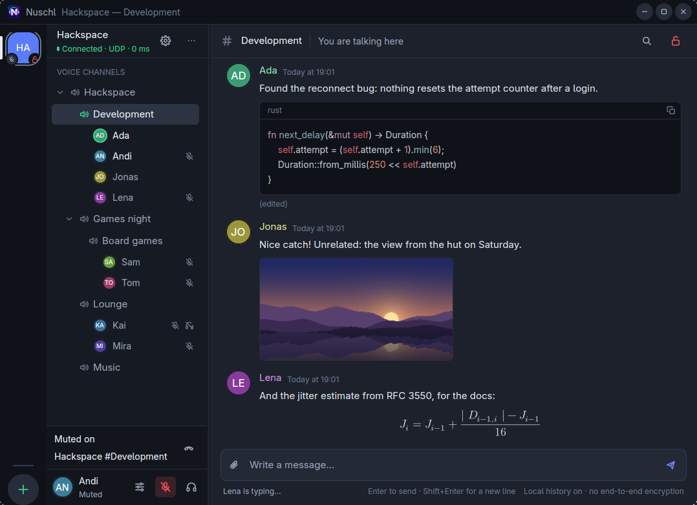

# Nuschl



Nuschl is a voice and text chat app for [Mumble](https://www.mumble.info/) servers.
It works with the Mumble servers you already use, keeps your chat history, and shows
code, images and formulas in messages. Nuschl also has its own server, `nuschld`,
which stock Mumble clients can use too: with Nuschl on both ends, the server keeps
the history, you can edit messages, and direct messages reach people who are
offline. End-to-end encryption is being built ([how far it is](#security-and-privacy)).
Nuschl's own code is memory-safe Rust, and what other people send you is handled in
sandboxed helper processes.

Nuschl is in early development, and things still change. Published versions and
their download files appear on [Releases](https://github.com/ambiso/nuschl/releases).
[CI builds](https://github.com/ambiso/nuschl/actions/workflows/build.yml) provide
testing snapshots, independently of release publication.
More about the app: [docs/desktop.md](docs/desktop.md).

## Install

Downloads for **0.1.0** include the required helper programs and licenses:

| Platform | Download |
| --- | --- |
| Windows x86_64 | [Portable ZIP](https://github.com/ambiso/nuschl/releases/download/v0.1.0/nuschl-0.1.0-windows-x86_64.zip) |
| macOS Intel and Apple silicon | [Universal app ZIP](https://github.com/ambiso/nuschl/releases/download/v0.1.0/nuschl-0.1.0-macos-universal.zip) |
| Linux | [Nix installation](#nixos-and-nix) |

Download the complete ZIP for your platform; the individual files on the release
page support automatic updates. Platform requirements and first-start instructions
are below.

### NixOS and Nix

Try it without installing anything:

```sh
nix run github:ambiso/nuschl
```

To keep it, add the flake as an input and install
`inputs.nuschl.packages.${pkgs.stdenv.hostPlatform.system}.default`, or use the Home
Manager module:

```nix
# flake.nix: inputs.nuschl.url = "github:ambiso/nuschl";
imports = [ inputs.nuschl.homeModules.default ];
programs.nuschl = {
  enable = true;
  autostart = true; # start minimised when you log in (Linux)
};
```

The module can also set settings and servers for you, which then show as read-only
in the app. The package registers `mumble://` and `nuschl://` links and updates with your flake
inputs, not by itself. Details, and what to do about `No GPU adapters found`:
[docs/install.md](docs/install.md#nix-and-nixos).

### Other Linux distributions

Not yet: there is no Flatpak, AppImage or distribution package. You can build it
from source (see [Development](#development)); it needs a Vulkan driver, and
bubblewrap (`bwrap`) for its sandbox.

### Windows

Windows releases use a portable zip, `nuschl-<version>-windows-x86_64.zip`, on the
[Releases page](https://github.com/ambiso/nuschl/releases). Unpack it into a folder of your own (not
Program Files) and start `nuschl.exe`. There is no installer yet; Nuschl updates
itself in that folder.

Releases are not code-signed for now, so on the first start Windows shows "Windows
protected your PC". Choose **More info**, then **Run anyway**. Windows with Smart App
Control turned on refuses unsigned apps altogether. The Windows build is tested in a
Windows 11 VM.

### macOS

macOS releases use `nuschl-<version>-macos-universal.zip` on the
[Releases page](https://github.com/ambiso/nuschl/releases), with `Nuschl.app` (Intel and Apple silicon,
macOS 14.2 or later). Move it to Applications first, so that it can update itself.
The app is not notarised for now, so macOS refuses the first start: then open
**System Settings → Privacy & Security** and choose **Open Anyway** next to the note
that Nuschl was blocked. The macOS build has not been tried on a Mac yet.

### A terminal client

`nix run github:ambiso/nuschl#tui -- mumble://you@voice.example.org` starts `nuschl-tui`
with the same servers and history, also over SSH (voice off there); `--plain` suits
screen readers, and F1 lists the keys.

### Android, iOS and the web

Android and iOS remain planned ([docs/clients.md](docs/clients.md)). The web client
supports text chat and local history. Host it with `nixosModules.web`, which serves
the app and its relay from your domain with ACME. TLS runs in the browser, so the
relay sees ciphertext. Browser voice, video and MLS remain unfinished
([docs/web.md](docs/web.md)).

## Getting started

**Add a server.** Click **+** in the left rail and enter the server's address and the
user name you want. On its first start Nuschl creates a certificate that Mumble
servers know you by; **Settings → Identity** can export it, for stock Mumble or a
backup. If a server's certificate is self-signed, Nuschl shows its fingerprint and
asks before connecting, once.

**Links.** A `mumble://` link (`mumble://voice.example.org/Games`) opens the server and
joins that channel. Right-click a channel and choose **Copy link** to share one, or
**Copy share link** for a web link (`https://nuschl.eu/join/…`) that opens the channel
in Nuschl ([docs/web.md](docs/web.md#share-links)). With
the Linux package, links open in Nuschl from your browser too; on Windows and macOS,
click them inside Nuschl for now. A link can also carry the server's certificate
fingerprint (`?fp=sha256:…`), and then nobody needs to confirm it.

**Talking.** Click a channel to read its conversation; double-click it to join its
voice. You join muted: unmute with the microphone button at the bottom left. Nuschl
then sends your voice whenever you speak. For push to talk, open Settings (the
sliders next to the microphone), choose **Push to talk** under Transmission, and
record a key under Shortcuts. The key also works while Nuschl is in the background,
where the desktop allows system-wide shortcuts (GNOME asks you once).

**Your microphone.** **Settings → Microphone test** lets you hear yourself as others
would and check for echo, without being on a server. Nuschl cancels echo and noise
itself, or uses the system's echo cancellation on Linux when it finds one.

## Running a server

`nuschld` is Nuschl's server. Stock Mumble clients (1.3 to 1.5) use it like the
standard Mumble server, and it can import an existing one with its users, channels
and permissions. The [NixOS operator guide](docs/server-operators.md) covers TLS,
web access, firewall rules, administrator setup, witnesses and backups. A minimal
NixOS server starts with:

```nix
imports = [ inputs.nuschl.nixosModules.default ];
services.nuschl = {
  enable = true;
  openFirewall = true;
  security = "compatible";
};
```

It keeps its data in SQLite, or in PostgreSQL (`database.type = "postgresql"` with
`database.createLocally = true`).

There are two security modes. **Compatible** admits stock Mumble
clients: messages and voice are encrypted on the way, as with any Mumble server, but
the server can read them. Experimental **end-to-end** mode accepts registered
Nuschl devices for MLS text and refuses stock clients. Voice is disabled in that
mode until encrypted media is implemented; use compatible mode for voice.

Configuration, administration, importing a Mumble server, and running it without
Nix: [docs/server.md](docs/server.md).

## A music bot

`nuschl-musicbot` plays music from Subsonic and OpenSubsonic servers (Navidrome,
Gonic, Ampache, …) in one or more Mumble channels, on stock servers too. Write `!web`
to it and it sends you a private link to a web page where you browse the libraries
(albums with covers, artists, playlists, search) and manage the queue. Its Svelte
player has live updates, scrubbing and drag-and-drop ordering. Queues, playback
positions and the latest 1,000 history entries per queue survive deployment
restarts. Its Mumble comment gives the instance address and link instructions.
Each channel has its own queue or shares another channel's. VAD-based ducking and
playback settings are adjustable on the page.
On NixOS: `imports = [ inputs.nuschl.nixosModules.musicbot ];` and
`services.nuschl-musicbot`; details in [docs/musicbot.md](docs/musicbot.md).

## Security and privacy

- **Sandboxes.** Message text and images, formulas, voice, file transfers, your local
  history and your keys are each handled by a sandboxed helper process of its own.
  Only the file-transfer helper may use the network, and only the history and key
  helpers reach a folder, each just their own. The sandboxes use bubblewrap on Linux and AppContainers on
  Windows (both tested), and Seatbelt on macOS (not yet tested). Details and
  exceptions: [SECURITY.md](SECURITY.md).
- **Encryption today.** Connections are encrypted (TLS, and Mumble's encrypted voice),
  but by default nothing is end-to-end encrypted: the server can read messages and
  hear voice. A red open lock in the app says so.
- **End-to-end encryption** is being built on MLS with post-quantum keys
  ([docs/e2ee.md](docs/e2ee.md)). Working now on Nuschl servers: an identity of your
  own that is the same on every server, and key transparency, which lets Nuschl
  notice when a contact's key changes or a server lies about it; safety numbers let
  you verify someone in person. End-to-end encrypted direct messages are an
  experiment, off by default; channels and voice come later.
- **Your data.** History is kept on your device, and on Nuschl servers also by the
  server (forever, unless the server or channel sets a shorter time). Server
  passwords are never saved. Where everything is stored:
  [docs/desktop.md](docs/desktop.md#where-nuschl-keeps-its-files).

## Development

Contributors and coding agents should read [AGENTS.md](AGENTS.md) for implementation
boundaries, worker contracts and coordination rules.

Everything comes from the flake's development shell:

```sh
direnv allow          # or: nix develop
just build            # build everything
just desktop          # build and start the app
just check            # formatting, Clippy, tests, licences and advisories
just vm               # Linux integration tests in NixOS VMs
just fuzz <target>    # fuzz a parser; `just fuzz-list` lists them
just readme-screenshot  # regenerate the picture above
```

Windows and macOS builds are cross-compiled on Linux (`nix build .#windows`,
`.#macos-app`). More in [docs/development.md](docs/development.md), what the tests
cover in [tests/README.md](tests/README.md), how it fits together in
[docs/architecture.md](docs/architecture.md), and what is next in the
[roadmap](TODO.md) and [GitHub issues](https://github.com/ambiso/nuschl/issues).

Releases are [prepared, signed and published locally](docs/local-release.md).
CI can build and check packages without receiving the release signing key.

## AI assistance

Most of Nuschl's own code and documentation was written with AI assistance.
The project is experimental and has not had an independent security audit.
See the [test coverage](tests/README.md) and [security notes](SECURITY.md) for
verification scope and known limits. Desktop, audio and cross-platform behaviour
still need testing on the systems where you use them.

## Licence

Nuschl is licensed under the [EUPL-1.2](LICENSE). Vendored Mumble schemas keep their
[upstream BSD licence](crates/protocol/proto/LICENSE.mumble). Emoji graphics are
[Twemoji](https://github.com/jdecked/twemoji) by Twitter, Inc and other contributors,
licensed under [CC-BY 4.0](https://creativecommons.org/licenses/by/4.0/); emoji names
and keywords are from [emojibase-data](https://www.npmjs.com/package/emojibase-data)
(MIT), derived from [Unicode CLDR](https://cldr.unicode.org) data under the
[Unicode License v3](https://www.unicode.org/license.txt) ([docs/emoji.md](docs/emoji.md)).
Dependency licences are reviewed in `deny.toml`; that allowlist does not replace
attribution or a licence-compliance review for releases.
