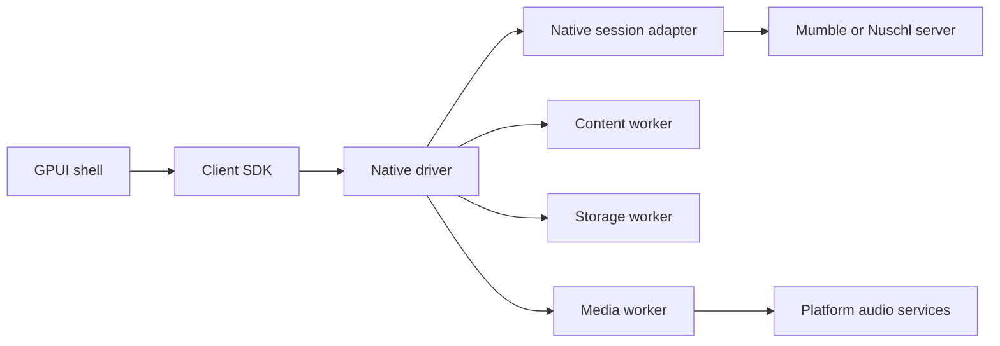

# Nuschl architecture

Nuschl separates a portable application model from desktop rendering, platform
services, and processing of untrusted input. GPUI is a desktop choice, not the
application framework for every platform. Small typed interfaces keep renderer and
platform decisions reversible without duplicating the session model.

## Workspace ownership

| Package | Responsibility | Dependencies it must not acquire |
| --- | --- | --- |
| `nuschl-core` | Domain values, session values, saved servers, typed content, non-destructive message previews | UI, network runtime, database, native FFI |
| `nuschl-client` | The client SDK (docs/clients.md): timelines, conversations, servers and their rules, the `Client` with its platform trait; with `native`, the driver over sessions and workers | GPUI, SQLite, codecs, platform device handles; without `native`: tokio, I/O, a clock |
| `nuschl-protocol` | Mumble protobuf schemas and bounded control framing | UI, audio decoding, sockets |
| `nuschl-rtc` | str0m WebRTC state machine, bounded SDP and encoded audio/video | UI, sockets, codecs, device handles, database |
| `nuschl-session` | Native TLS/control sessions, identities, bookmarks and worker supervision | GPUI, SQLite implementation, content parser, codecs |
| `nuschl-cli` | Diagnostic frontend using the real session implementation | GPUI, audio codecs |
| `nuschl-ipc` | Versioned worker messages, framing, and native supervision | Content parser, SQLite, codecs |
| `nuschl-content` | Message Markdown and formulas in one bounded parse (syntax hidden, lines kept), legacy HTML to inert text, syntax highlighting | Network access, database, native regex engines |
| `nuschl-storage` | SQLx/Tokio history operations for SQLite and PostgreSQL | UI, session credentials, arbitrary SQL from IPC |
| `nuschl` | GPUI desktop shell and native application supervision | Direct parser, database, or codec implementation |
| `nuschld` | Server session/routing authority and native transports | GPUI, content parser, audio decoding |
| `nuschl-content-worker` | Parse and highlight untrusted content | Credentials, microphone, user files, network |
| `nuschl-media-worker` | Audio device adapters, DSP, Opus | Server credentials, history database, arbitrary files, network |
| `nuschl-storage-worker` | Own the explicitly selected history database | Server credentials, microphone, network |
| `nuschl-musicbot` | Credential/network parent for Subsonic playback, queues/history and authenticated web controls; fixed isolated decode/encode/duck child roles handle codecs/DSP (docs/musicbot.md) | Parent: codec/DSP execution, GPUI, user private identity keys; children: credentials, network, audio devices, state files |

Worker dependencies are restricted with cargo-deny's wrapper rules. The shell and
server exchange typed commands and results with workers rather than linking the
native processing implementations. The server routes compressed voice; it should
not decode or re-encode participants' audio.

The shared crates form a small portable layer, not a general plugin system or a
large collection of traits for hypothetical backends. Add interfaces around concrete
needs: commands, events, message values, route observations, and effect plans.

## Execution and trust

The native session adapter owns TLS identity, server authentication, control state,
encrypted UDP voice with TLS fallback, reconnection and typed connection events.
Workers receive only the data and capabilities they
need. In particular, the media worker receives Opus/PCM and route instructions, not
the credentials or encryption keys that authenticate the Mumble session.

Memory-safe implementations are preferred before introducing a new process exception.
Workers also contain panics, excessive CPU use, and native/SIMD implementation risks.
A process boundary alone is not an OS sandbox. The supervisor must limit inherited
handles, environment, filesystem/network access, outstanding work, memory, and lifetime.
Current enforcement and exceptions are recorded in [the safety policy](../SECURITY.md).

Optional local Kokoro TTS and Voxtral Realtime captions are planned in
[the speech design](speech.md). Inference belongs in its own restricted process,
separate from live media callbacks and the media worker, with verified model files
downloaded on demand. Vulkan, optional Nix ROCm, Metal and CPU are backend targets;
model support and confinement must be validated per backend before shipping.

Control IPC is a versioned, length-prefixed JSON protocol with a 12 MiB limit checked
before allocating a frame body (inline images make content and history replies the
largest frames). Unknown versions, truncated frames, and oversized
results fail explicitly. Helpers are selected by trusted executable paths and
communicate over inherited pipes, not a publicly listening socket. Request IDs are
checked by the supervisor. Worker stderr must never become protocol stdout.

The media harness uses the same protocol for codec checks. Live control and small
compressed Opus frames use bounded JSON IPC with capture generation tags; PCM stays
inside the worker. Measured cost is 7.4 µs per packet each way (0.15% of a core with
four talkers), so a binary transport is not warranted (see
[the DSP evaluation](dsp-evaluation.md)). Do not introduce shared writable memory
merely for performance without reviewing the new trust boundary.

The UI and network event loop must not wait synchronously for parsing, disk, or DSP.
The native audio callbacks only convert samples and move them through lock-free SPSC
rings; underruns are counted with one relaxed atomic. A test runs both converters under
a counting allocator and requires zero allocations. Drop stale audio rather than
building latency; apply a different durability policy to chat.

## Content and history

Store the original message independently of its presentation. Preserve newlines and
blank lines (between blocks as `ContentBlock::Break`s); interpret Markdown (code,
formulas, emphasis, links to allowed targets, headings, lists, quotes, rules) without
interpreting raw HTML or loading resources.
The content worker returns text and style runs, not HTML, scripts, or image URLs to
execute. Renderer adapters remain responsible for selection, accessibility, focus,
layout, and a keyboard-accessible Show more action.

Desktop previews collapse when their measured wrapped height exceeds 300 logical
pixels. The full message remains available for expansion, copying and history.
The timeline lays out visible rows; offscreen accessibility entries remain exposed.
Bounding retained message memory while paging an active timeline is still open.

Parsing and history each have explicit limits. The content limit is 256 KiB;
the adapter must report a rejected message rather than silently truncate it. Revisit
the storage limit separately when adding attachments or legacy HTML. Legacy Mumble
HTML is converted to inert text and supported style runs in the content worker:
entities and line breaks are preserved, executable/resource elements are discarded. Images
embedded as `data:` URIs (as stock Mumble sends them) are decoded in the content
worker; remote images and arbitrary HTML/CSS are not rendered.

History is on by default, including with stock servers. Server and channel identities
scope queries; persist author display snapshots and local observation timestamps.
Connection session IDs are not durable author identities. Mark disconnected intervals
in the timeline. Do not deduplicate repeated text or fabricate missed messages.

The storage worker uses SQLx with Tokio: SQLite WAL for local history and PostgreSQL
for server persistence. Separate embedded migrations account for dialect differences
and track checksums through SQLx. Statements bind parameters. SQLite needs only the
chosen database directory, including WAL/SHM sidecars; PostgreSQL needs a connection to
its configured database and that database's credential. No worker request can select
another database or execute SQL. Keep database credentials outside command lines and
Nix store values; the server module uses systemd LoadCredential.

## Audio configuration and recovery

Audio policy operates on observations of the selected capture and playback path.
For AEC, noise suppression, and gain control separately, evidence is active,
inactive, or unknown. Missing metadata is not proof that processing is absent.

Reuse confirmed upstream effects. An upstream AEC also needs a reference that covers
Nuschl's actual speaker output: move Nuschl's own playback connection to the matching
reference when possible. Do not reconfigure an unrelated processor, change global
defaults, move another application's stream, or change hardware gain to make a local
optimization. If the route is opaque, retain the uncertainty and expose a device-level
override rather than stacking a speculative second canceller.

The in-application DSP is Rust: Sonora for WebRTC-derived AEC and AGC2, nnnoiseless
for RNNoise-derived suppression, and opus-pure for the codec. Their interoperability,
robustness and cost are measured in [the DSP evaluation](dsp-evaluation.md); perceptual
quality on recorded speech is still open. Being written in Rust is not proof of memory
safety or correct Opus output. Codec and
DSP SIMD remains confined to the media worker. Native PipeWire or platform processing
can be reused when it is already working well on the active route.

When Nuschl's own canceller runs, its reference is a recording of the output device,
not Nuschl's playback buffer (`reference.rs`): PipeWire captures the sink, PulseAudio
records its monitor (on a connection of its own; see TODO.md), WASAPI and Core Audio
(process tap, macOS 14.2) record in loopback. Every application's sound is removed
from the microphone, and the reference is exactly what played, on the device's clock.
Without such a recording (raw ALSA) the output callback records what it hands to the
device. The output is recorded only while the microphone is open and Nuschl's
canceller is in use, inside the media worker, and is never sent anywhere. Each device
callback stamps its samples on one clock (the worker's epoch, corrected by cpal's
reported latency); the worker feeds the canceller every reference frame that sounded up
to 25 ms after the microphone frame it is processing, holding the microphone up to
40 ms when the recording lags, so the canceller never receives an echo before its
reference. Up to two reference channels are kept; AEC3 runs mono until they differ
(stereo music, games) and then models each speaker's path separately.

On Linux, Nuschl recognises PipeWire and PulseAudio echo-cancel nodes, reuses them,
and routes only its own playback to the paired reference sink. On Windows, the planned
source is `IAudioEffectsManager` (active stream effects and change notifications) and
`IAcousticEchoCancellationControl`. On macOS it is the voice-processing I/O unit, whose
gain control and other-audio ducking must be evaluated against Nuschl's ownership rule.
Both need COM or Objective-C calls through unsafe bindings and validation on those
systems, so they are not implemented. On Windows and macOS, Automatic mode cannot see a
system canceller and therefore runs Nuschl's own; the per-microphone override lets
users turn it off where the system (or a headset) already cancels echo.

While audio is active, observe residual echo, clipping, noise, underruns, latency, and
near-end speech preservation. The media worker's adaptive controller (`adaptive.rs`)
does this in two-second windows with hysteresis. Device underruns raise Nuschl's
playback buffer (40 to 120 ms) and it relaxes after a clean minute. Persistent residual
echo during far-end speech makes the voice gate demand clearer speech while only the
far end talks. A clipping microphone is reported to the user, since its level is not
Nuschl's to change. Use far-end-only and double-talk conditions correctly;
silencing the microphone does not count as better cancellation. Apply hysteresis and
allow AEC to converge. Do not claim ERLE when the required unprocessed reference is
unavailable. Monitoring is local and does not save microphone audio by default.

Device changes and audio-server restarts invalidate device handles, link IDs, reference
timing, and DSP state. Increment the route generation; stop old callbacks; discard old
queued PCM; re-enumerate; recreate Nuschl-owned resources; re-evaluate effects; resume.
Keep network/chat state alive. One media worker serves every server (clients.md,
"Voice on several servers"); opening or closing the microphone replaces it, so blocked
native stream destructors cannot retain microphone access. Automatic recovery must not repeatedly undo an explicit
user routing change.

## Protocol and server compatibility

Support stock clients against the new server and the new client against stock servers.
Share the vendored Mumble schemas, but test behavioral compatibility separately: TLS
client certificates, authentication, permissions, channel state, whisper targets,
mute/deafen, UDP reachability, nonce resync, and TCP tunneling. Mumble's historical OCB
packet format must not be substituted with a generic modern OCB implementation.
Handle both legacy UDP encoding and the protobuf format introduced with Mumble 1.5.

Nuschl is trialing str0m 0.25 for its modern WebRTC media transport. C++ and Go
WebRTC implementations remain excluded, including implementations hidden behind
Rust bindings or isolated workers. `nuschl-rtc` owns the socket-independent state
machine; callers route datagrams and honor its timer deadlines. Capture, playback,
DSP and codecs remain in the media worker. The trial does not replace the Mumble
session transport or establish browser interoperability and sustained-call quality.
Existing platform and cryptographic exceptions remain governed by the safety policy.

The trial has bounded SDP (32 KiB, at most two media sections), UDP input (2 KiB),
Opus packets (1,275 bytes), and encoded video frames (256 KiB). Receive reordering and
retransmission caches are configured explicitly. These are input/cache limits, not
a proof of a hard total-memory bound for upstream protocol internals. Video admission
reserves 96 kbit/s for audio plus transport overhead, reacts to BWE events and rejects
frames exceeding its pacing budget or 120 ms of estimated transmission time. This
does not guarantee a bound on real network delay. Rejection means drop/adapt,
never save the frame in an unbounded retry queue. This conservative guard complements
str0m's pacer; a real encoder must also adapt bitrate and handle keyframe requests.
Dropping interframes requires tracking frame dependencies or obtaining a new keyframe;
the current video probe deliberately sends independent keyframes only.

Modern sessions should use WebRTC for voice, video and screen sharing, with an SFU
forwarding encoded media. Legacy sessions retain Mumble voice and text; stock Mumble
servers cannot relay video. A future server can bridge compatible Opus packets without
decoding them, but must translate timing/routing and enforce channel authorization.
Do not route video through Mumble TCP tunnels. MLS-required sessions must not bridge
plaintext legacy participants. SFrame with MLS-exported keys is the intended future
media encryption layer; DTLS-SRTP by itself does not provide E2EE through an SFU.

Persistent chat, server message IDs, history pagination, and independent text-channel
subscriptions require a capability-negotiated extension (designed in
`docs/extension.md`: ALPN plus a capability list in `Version`, per-conversation
sequence numbers, idempotent sends, subscriptions, ACL-checked history pages). Stock clients continue to
receive ordinary live TextMessage messages; stock servers provide live chat plus local
history in Nuschl. Authentication and channel ACLs must govern history as well as live
messages. Persistently address a conversation without relying on transient session IDs.

Keep history writes and pagination off the voice-routing critical path. Apply rate
limits and bounded queues per connection. Do not let a slow reader or a large history
query block the server's control state machine or voice forwarding.

## Desktop navigation and complete history

The desktop has a narrow server rail, a channel pane (208 logical pixels initially),
and the conversation. Channels remain a hierarchical tree, including channels that
have both children and a conversation. A single click selects text history; it must
never move a voice connection. A double-click joins voice, as does the explicit Join voice button. Branch toggles
consume pointer events so expanding a branch cannot join voice. Only root branches
start expanded; explicit expansion choices survive updates during the session.
Remember the selected conversation for each server. Tree branches, server selection,
channel selection, and message expansion support pointer and keyboard activation.

The portable navigation model issues a generation-tagged history ticket whenever a
conversation is selected. Ignore late responses after switching away, including
switching back to the same channel. The desktop executes local history requests asynchronously through the storage worker.
History is scoped to the endpoint and observed server certificate; cached channel names
allow offline browsing. Direct messages use peer certificate hashes when available,
otherwise a connection-specific identity avoids merging reused session IDs.

For a Nuschl server, show all retained history the authenticated member is authorized
to read, including messages from before their current connection. Fetch older pages
as the user scrolls; complete access does not mean an unbounded response or allocating
the whole archive. Stock servers fall back to local observations with explicit gaps.
Check current channel ACLs on every page; a capability announcement is not permission.
Use durable conversation identities, an authenticated server identity, and stable
server message IDs. Persist before acknowledging a new message; retries need an
idempotency key rather than deduplication by text or timestamp. Membership changes,
retention, moderation, edits, and deletion/tombstone policy must also apply to history.

The storage worker implements exclusive-ID paging for SQLite and PostgreSQL. It
returns chronological pages capped at 100 messages and 96 KiB of unescaped text,
with a cursor when older records remain. Byte limits must not silently skip a message.
Concurrent inserts do not shift older pages. IDs are scoped to a database and query;
the session adapter must not treat an arbitrary remote cursor as authorization.
The existing plaintext message table supports local and non-E2EE server history.

## MLS and encrypted history

MLS is a separate, strict server security policy, not an optional decoration on a
legacy session. A legacy-compatible server continues to support stock Mumble clients
and transport encryption, but the server can read message and audio content. An
MLS-required server rejects clients without the negotiated MLS protocol and must not
silently downgrade, bridge plaintext to a legacy participant, or expose decrypted
history through legacy APIs. Operators can run separate server instances for the
two policies. Experimental strict encrypted text and archive handling are implemented
with OpenMLS in the crypto worker. Full historical membership and first-observation
ordering proofs remain open; unavailable signer/key evidence yields explicit gaps.
Encrypted servers block unprotected voice until SFrame exists.

The client shows a red open lock for transport-only sessions and a green closed lock
only after the authenticated MLS session is established. Unknown or negotiating state
has a neutral or pending indicator. A server advertisement or configuration flag
cannot produce a green lock. Labels explain "no end-to-end encryption" so that users
do not confuse transport encryption with E2EE. Conversation locks derive from
authenticated crypto-worker state; an advertisement alone cannot establish them.

Identities are separate by protocol. The Mumble identity is an RSA-2048 X.509
TLS client certificate used only for Mumble logins; stock Mumble imports only
RSA keys, so this keeps it portable as PKCS#12. Nuschl-native/MLS identities are
independent device keys and credentials, never derived from the Mumble
certificate; an optional signed binding may link both for one person, without
either depending on the other. Mumble's constraints do not shape MLS.

Cipher suites are negotiated and upgradable. Post-quantum confidentiality comes
first (a hybrid ML-KEM/X25519 KEM such as X-Wing, available experimentally in
OpenMLS), then post-quantum authentication with ML-DSA, preferably hybrid with
Ed25519, once draft-ietf-mls-pq-ciphersuites settles. Group re-initialisation must
move existing groups to a new suite without losing membership.

Use an existing Rust MLS implementation after dependency/security review, in a
dedicated crypto worker that owns credentials, ratchet state, key deletion and
transactional state persistence. Bind member credentials to verified device identities,
channel authorization, and the correct server/group identity. Plan one MLS group per
conversation; membership/ACL changes must be reflected in committed group membership.
MLS application messages protect chat. Voice needs an independently specified media
encryption protocol with exported keys, replay protection, sender identity and epoch
handling. Chat-only encryption must not turn the whole server's voice/chat badge green.

MLS forward secrecy depends on deleting old epoch/message secrets; adding a member
does not automatically grant access to all earlier messages. See
[RFC 9420, sections 12.4.3.1 and 16.6](https://www.rfc-editor.org/rfc/rfc9420.html#section-16.6).
Full persistent history therefore needs a separately specified encrypted archive,
client-held archive keys, and an explicit policy for granting historical access to
new members and devices. Do not retain all MLS epoch secrets just to decrypt an archive.
Historical-access policy and archive-key rotation/recovery must describe their own
compromise and revocation limits; access to retained history changes the protection
available after a device compromise. Offline delivery, expired membership and key loss
need visible gaps instead of promises that every stored ciphertext can be decrypted.

An MLS server stores opaque authenticated ciphertext and delivery metadata in a
separate storage representation, never decrypted `ChatMessage` bodies or group secrets.
Its role is delivery and archive authorization, not a hidden member with decryption
keys. Local decrypted history stays on the device under the user's history policy;
at-rest protection and device key recovery need OS credential-store integration.
The crypto worker must not get the server database credential or unrestricted network
access. The storage worker must not get live MLS private keys.

## Mobile and browser adapters

The client choices are SwiftUI + UniFFI for iOS, Compose + UniFFI for Android, and
Svelte + WASM for the browser (docs/clients.md). iOS is the first mobile priority.
Core and client state
must compile for WebAssembly without GPUI, Tokio's native sockets, SQLite, or CPAL.
Native mobile adapters must handle microphone permissions, audio-session changes,
interruptions, background execution, and platform call integration.

iOS does not offer the desktop helper-process model to an ordinary application.
Do not assume the worker topology can be copied unchanged. Prefer memory-safe
in-process parsing/processing on mobile, use OS-native services where appropriate,
and review each remaining native exception against the mobile application's sandbox.
GPUI mobile/web experiments are not a commitment to that distribution path.

A browser cannot directly speak Mumble's TLS TCP and encrypted UDP protocol. A web
client needs an explicit server-side gateway, with WebSocket/HTTP control and a
browser-compatible media transport. Shared Rust state can be reused without pretending
that the native network adapter or background-audio behavior transfers to a browser.

## Builds and integration tests

Nix pins the toolchain, native dependencies, checks, and advisory snapshot. Native
Linux and Darwin derivations are the initial build surface. Linux-to-Darwin can follow
`../opendeck-akp05`: pinned SDK, cargo-zigbuild, two architecture slices, and llvm-lipo.
GPUI shader generation and native dependencies must pass a real cross-build before
adding a release target. Do not label an untested cross-build a supported release.

NixOS VM tests should cover all three new client/server combinations, with stock/stock
as the baseline. Real stock Mumble applications are necessary; a protobuf fixture or
TCP connect probe alone is not interoperability. The [test plan](../tests/README.md)
defines progression from packaging to control, voice, recovery, and history behavior.
Linux VM tests complement physical Windows/macOS audio and accessibility testing.
