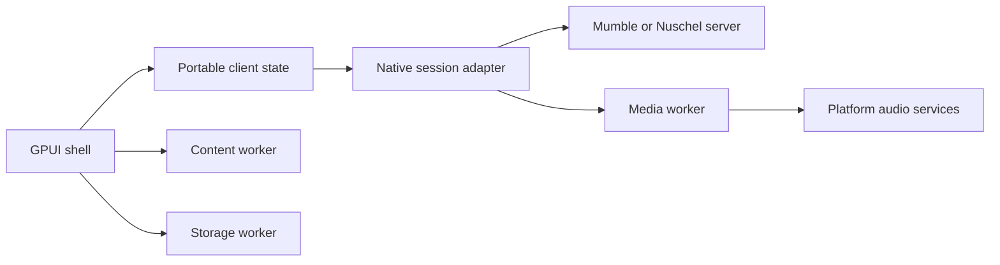

# Nuschel architecture

Nuschel separates a portable application model from desktop rendering, platform
services, and processing of untrusted input. GPUI is a desktop choice, not the
application framework for every platform. Small typed interfaces keep renderer and
platform decisions reversible without duplicating the session model.

## Workspace ownership

| Package | Responsibility | Dependencies it must not acquire |
| --- | --- | --- |
| `nuschel-core` | Domain values, typed content, non-destructive message previews | UI, network runtime, database, native FFI |
| `nuschel-client` | Client preferences, state transitions, audio policy | GPUI, SQLite, codecs, platform device handles |
| `nuschel-protocol` | Mumble protobuf schemas and bounded control framing | UI, audio decoding, sockets |
| `nuschel-ipc` | Versioned worker messages, framing, and native supervision | Content parser, SQLite, codecs |
| `nuschel-content` | Literal text, fenced code parsing, syntax highlighting | Network access, database, native regex engines |
| `nuschel-storage` | Parameterized SQLite history operations | Network or UI |
| `nuschel` | GPUI desktop shell and native application supervision | Direct parser, database, or codec implementation |
| `nuscheld` | Server session/routing authority and native transports | GPUI, content parser, audio decoding |
| `nuschel-content-worker` | Parse and highlight untrusted content | Credentials, microphone, user files, network |
| `nuschel-media-worker` | Audio device adapters, DSP, Opus | Server credentials, history database, arbitrary files, network |
| `nuschel-storage-worker` | Own the explicitly selected history database | Server credentials, microphone, network |

Worker dependencies are restricted with cargo-deny's wrapper rules. The shell and
server exchange typed commands and results with workers rather than linking the
native processing implementations. The server routes compressed voice; it should
not decode or re-encode participants' audio.

The shared crates form a small portable layer, not a general plugin system or a
large collection of traits for hypothetical backends. Add interfaces around concrete
needs: commands, events, message values, route observations, and effect plans.

## Execution and trust

The native session adapter owns TLS identity, server authentication, control state,
encrypted UDP, and reconnection. Workers receive only the data and capabilities they
need. In particular, the media worker receives Opus/PCM and route instructions, not
the credentials or encryption keys that authenticate the Mumble session.

Memory-safe implementations are preferred before introducing a new process exception.
Workers also contain panics, excessive CPU use, and native/SIMD implementation risks.
A process boundary alone is not an OS sandbox. The supervisor must limit inherited
handles, environment, filesystem/network access, outstanding work, memory, and lifetime.
Current enforcement and exceptions are recorded in [the safety policy](../SECURITY.md).

Control IPC is a versioned, length-prefixed JSON protocol with a 1 MiB limit checked
before allocating a frame body. Unknown versions, truncated frames, and oversized
results fail explicitly. Helpers are selected by trusted executable paths and
communicate over inherited pipes, not a publicly listening socket. Request IDs are
checked by the supervisor. Worker stderr must never become protocol stdout.

The initial media harness uses the same protocol for codec checks. Real-time audio
needs a separate bounded binary data path with explicit format/generation metadata
and backpressure. Avoid serializing every live PCM frame as JSON. Do not introduce
shared writable memory merely for performance without reviewing the new trust boundary.

The UI and network event loop must not wait synchronously for parsing, disk, or DSP.
The native audio callback must not allocate, lock, write logs, or perform IPC itself.
Preallocated bounded queues connect callback I/O to media processing. Drop stale
audio rather than building latency; apply a different durability policy to chat.

## Content and history

Store the original message independently of its presentation. Preserve newlines and
blank lines; interpret fenced code without interpreting raw HTML or loading resources.
The content worker returns text and style runs, not HTML, scripts, or image URLs to
execute. Renderer adapters remain responsible for selection, accessibility, focus,
layout, and a keyboard-accessible Show more action.

Initial previews collapse after 12 physical lines or 2,000 Unicode scalar values.
This handles both pasted documents and long single lines. The full message remains
available for expansion, copying, and history. A production renderer should also
use its measured layout height to handle narrow windows and text scaling.

Parsing and history each have explicit limits. The initial content limit is 64 KiB;
the adapter must report a rejected message rather than silently truncate it. Revisit
the storage limit separately when adding attachments or legacy HTML. Legacy Mumble
HTML needs conversion in the content worker to an inert supported subset before
claiming full rich-text interoperability.

History is on by default, including with stock servers. Server and channel identities
scope queries; persist author display snapshots and local observation timestamps.
Connection session IDs are not durable author identities. Mark disconnected intervals
in the timeline. Do not deduplicate repeated text or fabricate missed messages.

The storage worker uses SQLite WAL and parameterized statements. Database schema
versions are explicit and a newer version is rejected. It needs access only to the
chosen database directory, including WAL/SHM sidecars. No worker request can select
another database path or execute SQL.

## Audio configuration and recovery

Audio policy operates on observations of the selected capture and playback path.
For AEC, noise suppression, and gain control separately, evidence is active,
inactive, or unknown. Missing metadata is not proof that processing is absent.

Reuse confirmed upstream effects. An upstream AEC also needs a reference that covers
Nuschel's actual speaker output: move Nuschel's own playback connection to the matching
reference when possible. Do not reconfigure an unrelated processor, change global
defaults, move another application's stream, or change hardware gain to make a local
optimization. If the route is opaque, retain the uncertainty and expose a device-level
override rather than stacking a speculative second canceller.

The preferred in-application DSP candidates are Rust: Sonora for WebRTC-derived AEC,
nnnoiseless for RNNoise-derived suppression, and opus-pure for the codec. Rust ports
still need interoperability, audio-quality, performance, and robustness evaluation;
being written in Rust is not proof of memory safety or correct Opus output. Codec and
DSP SIMD remains confined to the media worker. Native PipeWire or platform processing
can be reused when it is already working well on the active route.

On Linux, inspect PipeWire nodes/links and PulseAudio module/stream metadata. On
Windows, inspect active stream effects and effect-change notifications where the OS
supports them. On macOS, native voice processing is an option, but its gain control
and other-audio ducking must be evaluated against Nuschel's ownership rule.

While audio is active, observe residual echo, clipping, noise, underruns, latency, and
near-end speech preservation. Use far-end-only and double-talk conditions correctly;
silencing the microphone does not count as better cancellation. Apply hysteresis and
allow AEC to converge. Do not claim ERLE when the required unprocessed reference is
unavailable. Monitoring is local and does not save microphone audio by default.

Device changes and audio-server restarts invalidate device handles, link IDs, reference
timing, and DSP state. Increment the route generation; stop old callbacks; discard old
queued PCM; re-enumerate; recreate Nuschel-owned resources; re-evaluate effects; resume.
Keep network/chat state alive. Automatic recovery must not repeatedly undo an explicit
user routing change.

## Protocol and server compatibility

Support stock clients against the new server and the new client against stock servers.
Share the vendored Mumble schemas, but test behavioral compatibility separately: TLS
client certificates, authentication, permissions, channel state, whisper targets,
mute/deafen, UDP reachability, nonce resync, and TCP tunneling. Mumble's historical OCB
packet format must not be substituted with a generic modern OCB implementation.
Handle both legacy UDP encoding and the protobuf format introduced with Mumble 1.5.

Persistent chat, server message IDs, history pagination, and independent text-channel
subscriptions require a capability-negotiated extension. Stock clients continue to
receive ordinary live TextMessage messages; stock servers provide live chat plus local
history in Nuschel. Authentication and channel ACLs must govern history as well as live
messages. Persistently address a conversation without relying on transient session IDs.

Keep history writes and pagination off the voice-routing critical path. Apply rate
limits and bounded queues per connection. Do not let a slow reader or a large history
query block the server's control state machine or voice forwarding.

## Mobile and browser adapters

Mobile and web are future targets with open renderer choices. Core and client state
must compile for WebAssembly without GPUI, Tokio's native sockets, SQLite, or CPAL.
Native mobile adapters must handle microphone permissions, audio-session changes,
interruptions, background execution, and platform call integration.

iOS does not offer the desktop helper-process model to an ordinary application.
Do not assume the worker topology can be copied unchanged. Prefer memory-safe
in-process parsing/processing on mobile, use OS-native services where appropriate,
and review each remaining native exception against the mobile application's sandbox.
GPUI mobile/web experiments are not a commitment to that distribution path.

A browser cannot directly speak Mumble's TLS TCP and encrypted UDP protocol. A web
client needs an explicit server-side gateway, with WebSocket/HTTP control and a
browser-compatible media transport. Shared Rust state can be reused without pretending
that the native network adapter or background-audio behavior transfers to a browser.

## Builds and integration tests

Nix pins the toolchain, native dependencies, checks, and advisory snapshot. Native
Linux and Darwin derivations are the initial build surface. Linux-to-Darwin can follow
`../opendeck-akp05`: pinned SDK, cargo-zigbuild, two architecture slices, and llvm-lipo.
GPUI shader generation and native dependencies must pass a real cross-build before
adding a release target. Do not label an untested cross-build a supported release.

NixOS VM tests should cover all three new client/server combinations, with stock/stock
as the baseline. Real stock Mumble applications are necessary; a protobuf fixture or
TCP connect probe alone is not interoperability. The [test plan](../tests/README.md)
defines progression from packaging to control, voice, recovery, and history behavior.
Linux VM tests complement physical Windows/macOS audio and accessibility testing.
