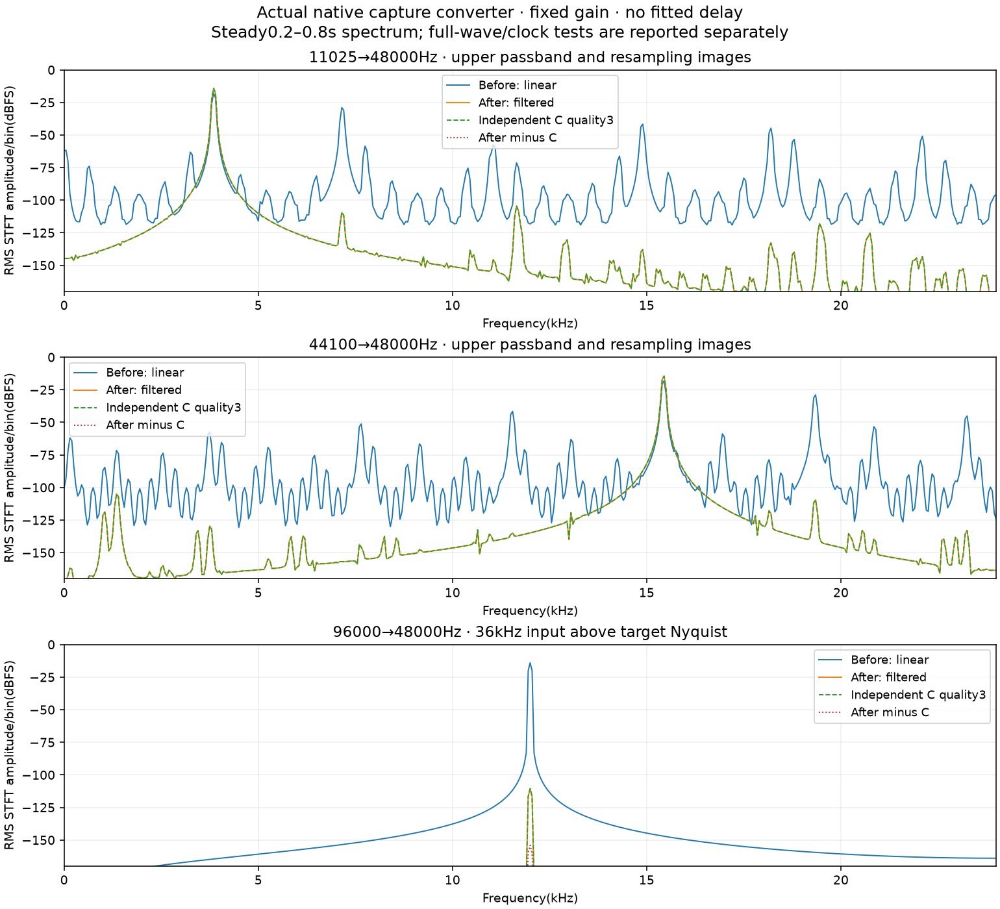

# Native capture conversion quality

At `89806ef2`, the actual native `CaptureConverter` still uses linear
interpolation/decimation, full-channel average and a unit input bound. The
untouched converter fixture (`20381267`) changes no production statement.
Independent C SpeexDSP 1.2.1 quality 3 is the source-matched SRC policy from pinned
Mumble `35dce9e4801fe52b2217f0d9f421d17b0aaf3bb0`,
[AudioInput.cpp:515–516,587](https://github.com/mumble-voip/mumble/blob/35dce9e4801fe52b2217f0d9f421d17b0aaf3bb0/src/mumble/AudioInput.cpp#L515). The C reference duplicates mono into two identical
independent filter channels and verifies equality before taking one; it does not
compare full Mumble capture/DSP/encoding or add its PCM16 quantization.

`tests/capture_quality.py` runs actual ignored native converter fixtures with
1/2/6 channel input, five device rates, low/high tones, an above-target-Nyquist
alias case and impulses. No delay/gain fitting occurs. Whole and fragmented
callbacks are byte-identical and one second remains 48000 output frames; this
count alone does not prove filtering or timestamp correspondence.

The frozen baseline command exits 1: 21 of 26 cases fail the unchanged 100 dB/2e-6
sample-agreement gate. All five 48 kHz bypass cases pass. Upper-band carriers lose
3.65 dB at 11.025/22.05/44.1 kHz input. Their images measure −14.4 dB versus C
−76.84…−94.96 dB. At 96 kHz, 36 kHz aliases to 12 kHz at approximately 0 dB, versus C −96.56 dB.
The tested 96 kHz impulse lies on a decimation phase the old converter discards;
its complete output is zero. No physical device, host audio, public server,
profile or native encoder is used, and no perceptual quality claim follows.

See [the preserved actual failure](reviews/2026-11-12-capture-baseline.json).
Raw float audio, scripts, plots, exact cached native fixture and logs remain
under `~/.cache/nuschl-capture-quality/`. The following correction retains this failed dataset and its original thresholds.

## Filtered production correction

A small `capture.rs` wrapper now uses `ReferenceConverter::new(1, rate)` as its
mono SRC engine. This reuses the reviewed memory-safe scalar Speex port without
changing reference/playback/mixer code or adding a dependency. All device
channels are averaged in f64, preserving cancellation before the existing unit
input clamp. Nonfinite frames remain silence; finite f32 channel sums cannot
overflow f64. Equal 48 kHz rates retain the direct path. Filtered conversion
processes actual input immediately, including a final partial stage in each
callback; it does not prefetch or wait for a whole callback/block.

The engine tracks accepted device frames and generated 48 kHz samples even if
its bounded mono ring drops samples. Before enqueueing, the actual input callback
anchors converted capture time at CPAL capture time minus filter delay and exact
rational phase; the stamper advances by samples successfully buffered. No rounded
10 ms source count is used. First-input marking, stream activation, capture
consent, microphone close on mute, DSP defaults, upstream selector and the Audio
transmit factory remain unchanged. The causal FIR still has real digital delay
(roughly 0.5–3 ms over supported rates); compensating its timestamp does not remove
that physical delay or claim zero-latency capture.

The new C oracle uses the actual mono `speex_resampler_process_float` entry point.
An explicit check confirmed that mono and the original stereo-duplication oracle
have the same stopband numerical result. All 26 original source buffers remain
byte-identical; five additional initial 997→3000 Hz markers test prefix retention.
The final 31 quality/clock cases pass, with whole/fragmented native PCM identical.
Ordinary output-referenced agreement is 133.60–161.11 dB, maximum sample error
1.49e−7. Independently C-queried latency and rational count checks show zero
nanosecond timestamp discrepancy in these fixtures; impulses map back to their
known capture instants within one 48 kHz sample. No delay/gain fitting occurs.

| Input rate | Upper passband, before | After / C | Images, before | After / C |
| --- | ---: | ---: | ---: | ---: |
| 11.025 kHz | −3.65 dB | −0.00113 / −0.00113 dB | −14.40 dB | −76.84 / −76.84 dB |
| 22.05 kHz | −3.65 dB | −0.00070 / −0.00070 dB | −14.41 dB | −94.96 / −94.96 dB |
| 44.1 kHz | −3.65 dB | −0.00070 / −0.00070 dB | −14.41 dB | −94.96 / −94.96 dB |

The 96 kHz 36 kHz→12 kHz alias drops from approximately 0 dB to −96.612 dB,
versus C −96.557 dB. Its output-relative 100 dB diagnostic remains **false** at
77.98 dB: the intentionally suppressed reference makes relative error sensitive
to float accumulation rounding. Raw max error is 2.65e−8 and residual RMS
−156.98 dBFS. This failed strict diagnostic and the first filtered report are
retained. The declared stopband-only acceptance rule uses fixed **input** RMS
(no fitted normalization): error ≥120 dB below input, unchanged max error ≤2e−6,
actual attenuation ≤−90 dB and no worse than C+0.5 dB. Measured input-referenced
agreement is 139.99 dB. All ordinary/impulse cases still require the original
output-relative 100 dB gate. Five real-PCM controls reject original aliasing,
injected stopband leakage, silence and a 10 ms delayed initial marker while
preserving that failed raw diagnostic. This is not bit-exact or perceptual parity.

## Actual private capture and privacy checks

The Nix worker passes 81 native tests, with eight explicit/old diagnostics ignored;
the capture dump helper was separately invoked. New units cover 1/2/6/32 channel
averaging, finite extremes and nonfinite input, no callback allocation, immediate
one-device-frame consumption, empty callbacks, overflow clocks/no replay and
clean stream reopen. No production source changed after `dfc1d3dc`.

Private Pulse microphone graphs exercise actual observed **s16le mono 44.1 and
96 kHz CPAL capture streams**, beyond a 48 kHz bypass. The original unmute test's
continuous/PTT/VAD, pacing, terminator/epoch, muted-no-mic and close-on-mute
assertions are reused unchanged. Warm current first packets arrive in
30.7–35.7 ms, with first usable packets in 35.0–56.3 ms. The baseline's first cold
virtual-source trials take about 1.8–1.9 seconds; current trials run after that
warm-up, so this difference is not credited as a converter improvement. These
are worker-command timings, not GUI clicks or hardware startup guarantees.

Separate private monitor/room echo checks inspect the actual hot input stream
rate on every run. An early fixture correctly failed when Pulse retuned an idle
44.1 kHz null mic to its 48 kHz room stream; an owned zero-valued stream now holds
the requested virtual mic rate. All attempts are preserved under the original
best-of-two convergence policy: 44.1 kHz reductions 47.19/45.69 dB and 96 kHz
42.83/45.86 dB, each with 0% transmitted; echo-off controls transmit 100%.
The full original default-rate DSP suite also passes: routes/overrides, jitter,
46 dB/0% echo, 2.1 dB/100% double-talk, clipping detection, −25 LUFS effects,
6 dB half-volume reduction and −92 dBFS transmitted effects. Private virtual sinks
and sources supply every sample; no host audio device, profile or public server
is accessed. Original convergence variability remains an open limitation.

## Evidence and remaining scope

[The structured correction proof](reviews/2026-11-12-capture-filtered.json)
contains exact source/test/worker hashes, all C/gate/clock data, actual negotiated
stream observations and every AEC attempt. Full owned artifacts are retained in
`~/.cache/nuschl-capture-quality/`. The cached plotting interpreter is
`/nix/store/igcsxi89qpy38gvz7d7qz6qrw9ii5gvw-python3-3.14.8-env/bin/python3`
(NumPy 2.5.3, Matplotlib 3.11.2). Run `tests/capture_quality.py` with the recorded
test binary/library and `--filtered`; `tests/capture_quality_test.py` consumes the
preserved baseline and corrected PCM. `tests/capture_unmute.py` and
`tests/capture_echo.py` reproduce the private runtime cases. Use a fresh owned
disk output directory and TMPDIR. Only cached Nix leaf/test/link builds ran at
2 cores/2 jobs, about 25 seconds each, with the five-second 8 GiB `/tmp` guard;
client scratch was disk-backed, daemon build-dir remained default.

Physical devices, Windows/macOS runtime, matched cold timing, broader backend/
clock/room conditions and the full input→DSP→encoder→network→output/listening
comparison remain in TODO. Scalar/C stopband rounding is reported explicitly;
no input-to-output bit-exactness or general AEC reliability claim follows.
