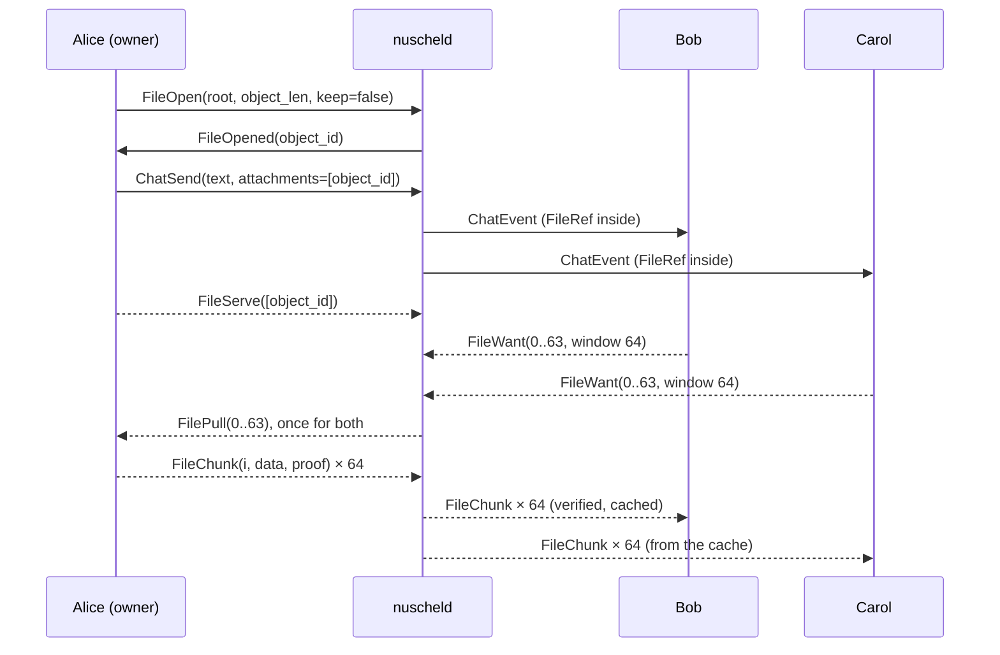

# Files on Nuschel servers (`files/1`)

Status: design for review (2026-11-11). Only the object format (§4.1) is implemented,
as a prototype with tests in `crates/files` (`nuschel-files`). It replaces the sketch
in [docs/extension.md](extension.md) §8 and [docs/e2ee.md](e2ee.md) §6.8, which now
point here, and settles the security review's D9
([docs/reviews/2026-11-11-server-security.md](reviews/2026-11-11-server-security.md)).
Open questions for the user are in §11.

On stock Mumble servers nothing changes: a file is a magic-wormhole receive code in
the message text, refreshed after each pickup, sent by the sandboxed transfer worker
(`apps/transfer-worker`, `crates/core/src/transfer.rs`, SECURITY.md). This document
is about Nuschel servers, where the client negotiated `files/1`.

## The conflict, and the short answer

The earlier design made every file an upload to the server's blob store. The user's
requirement is different for large files: "large file transfers should be possible
peer-to-peer (i.e. not saved on the server; but with the server as a relay (with
maybe a small chunk cache; with content defined chunking maybe)); this needs to be
clearly shown in the UI so that you know you're still uploading. They should also be
resumable if you restart the client or intermittently lose connection." Retention is
forever by default because "we don't want people to lose data", and several images or
files may go in one message.

Both are kept, as two classes of one thing:

- A **file object** is a file encrypted under its own random key in 64 KiB chunks,
  with a Merkle tree over the encrypted chunks. Its root goes in the message, so every
  chunk is verified before it is written, whoever delivered it. The format is the
  same for both classes, in both server modes.
- A **kept** object is uploaded to the server and lives as long as the message that
  references it (forever by default). Images and small files are kept by default, so
  offline members, and new members with history, get them.
- A **live** object stays on the sender's disk. Recipients fetch it through the
  server, which relays chunks and caches a few in memory but stores nothing. It is
  available while the sender's device is online and sharing it. Large files are live
  by default; the sender can **keep** one later (the server then pulls the chunks it
  lacks; the message does not change).
- In both classes **the sender only answers pulls**. The server pulls chunks from the
  sender, into its store for a kept object and on behalf of recipients for a live one.
  Uploads, relays, pinning and resumption are one mechanism.
- Transfers run on a **second TLS connection to the same port** (ALPN
  `nuschel-bulk/1`), so bulk data never queues in front of chat, control or tunnelled
  voice. Direct connections between peers come later, opt-in, over the same chunk
  frames.
- No content-defined chunking: with a fresh key per file it deduplicates nothing,
  resumption does not need it, and its chunk lengths would show the server
  information about the plaintext (§2.7).

## 1. Two classes

### 1.1 What each class is

| | Kept | Live |
| --- | --- | --- |
| Where the bytes are | Server's blob store (ciphertext) | Sender's disk; the server relays |
| Available | As long as a referencing message exists (retention, forever by default) | While the sender's device is online and sharing |
| Offline recipients | Download any time | See the message; download starts when the sender is next online |
| New members with history | Get it (the key is in the archive record, §4.2) | Get the key; download while the sender shares |
| Server disk | Charged to the sender's quota | None (a bounded memory cache) |
| Typical | Images, documents, short clips | Videos, disk images, archives, datasets |

A message may carry kept and live attachments together. The class is server-side
state of the object, not part of the encrypted message: keeping a live object later
(§1.4) changes nothing that recipients already hold.

### 1.2 Where the boundary is

**Recommendation: by size against the server's policy, overridable by the sender.**

- The server announces its file policy in the hello (`files.max_kept_object`, default
  100 MiB, and whether kept files are allowed at all) and each account's remaining
  quota on request (§5.3).
- The composer makes an attachment **kept** if it fits under both, otherwise **live**.
  Each attachment chip shows which and has a menu: "Keep on the server" (allowed up to
  `max_kept_object` and the remaining quota) or "Send from this device".
- If the server refuses a kept upload at send time (quota, disk reserve; §5.3), that
  attachment becomes live and the chip says why. The message is never lost for it.
- Thumbnails of images (and later poster frames of videos) are always kept, even for a
  live file, so the timeline shows something for every attachment while the sender is
  away.

Alternatives considered:

| Option | Why it loses |
| --- | --- |
| Everything kept | Large files fill the server and contradict "not saved on the server" |
| Everything live | Offline and new members lose images and small files whenever the sender is away; contradicts "don't lose data" |
| Server decides by size only | A sender cannot keep a private file off the server, or keep a large one an operator would allow |
| Sender chooses every time | Friction on every attachment; people cannot judge server limits; most choices would be the default anyway |

The size limit is not a cap on what can be sent: a file over it still goes, live.

### 1.3 What offline recipients see

- **Kept:** the message and a file card; images show their thumbnail at their final
  size (width and height travel in the message, so nothing shifts when the image
  arrives). Download any time; if the upload is still running, the card says so and a
  download follows it.
- **Live, sender online:** "From Alice's computer", with Download.
- **Live, sender offline:** "Alice's device with this file is offline", with
  "Download when available". The recipient's client remembers that and starts on its
  own once the server reports the sender back (§3.4).
- **Ended** (the sender stopped sharing, the file is gone from the sender's disk, or the
  message was deleted): "No longer available". The message and its text stay.

### 1.4 Keeping and releasing later

The owner can keep a live object at any time ("Keep on the server" on the card): the
server checks size and quota, marks it kept, and pulls the chunks it does not have yet
from the sender (§2.2), verifying each against the root it already holds. Nothing new
is sent to recipients; their cards change from "From Alice's computer" to "On the
server" when the server reports the new state. The owner can also release a kept
object, which becomes live (if the owner's device still shares it) or ended. Only the
owner can keep or release, because the owner's quota pays. Another member who wants a
file kept forwards it, which makes a new object under a new key (§4.3).

### 1.5 Retention, deletion and history grants

- A kept object is reference-counted by the messages that reference it. When the last
  one is deleted, expires (extension.md §6) or is erased by the operator, the object is
  removed with it. The key goes with the message: in compatible mode it is in the
  message row, which is overwritten (`secure_delete`); in end-to-end conversations the
  server never had it. Ciphertext left on disk is unreadable either way. In end-to-end
  conversations a deletion is an envelope inside MLS that the server cannot read; the
  attachments are released by the server-visible purge request that accompanies it
  (e2ee.md §6.3, item 4).
- A live object ends when its last referencing message goes: the server stops
  relaying (authorisation needs a referencing message, §5.1) and the sender's client
  stops sharing when it sees the deletion.
- A live share has no lifetime of its own: it lasts until the sender stops it, deletes
  the message, or the file changes or disappears on the sender's disk (open question
  2). The sender's Transfers panel lists every share.
- Live-only conversations (retention "none") keep no messages, so nothing can be kept;
  attachments there are live, for the people present, and end with the sender's
  session.
- **History grants (e2ee.md §6.6).** Attachments travel in the message envelope and in
  its archive record (§4.2), so a member granted history keys can decrypt every
  attachment of the retained history: kept ones from the server, live ones from the
  sender while it shares. `since_access` intervals apply to files as to text: the server
  serves an object only to someone who may read a referencing message (§5.1).

## 2. Transfers: transport, relay and flow control

### 2.1 Transport

**Recommendation: a second TLS connection to the server's TCP port, ALPN
`nuschel-bulk/1`, opened while transfers run.**

- The client asks for a ticket on its control connection (`BulkTicket`: 32 random
  bytes, single use, valid 60 seconds, bound to the session) and opens a TLS connection
  to the same address and port, offering only `nuschel-bulk/1` and presenting the same
  client certificate. Its first frame is `BulkHello { ticket }`; the server checks the
  ticket and the certificate hash against the session, or closes the connection. Before
  that, the only accepted frame is `BulkHello` (≤ 64 bytes) within the handshake
  timeout, as for `Version` on the control connection.
- One bulk connection per session. It ends with the session; both reconnect together
  and transfers resume (§3). It does not count as a user (`max_users`), and the
  per-address connection caps count it with its session.
- Framing is the Mumble control framing with types from the `nuschel.v1` block (§9),
  so `crates/protocol` and the per-type limits apply unchanged. A bulk frame on the
  control connection, or a control frame on the bulk connection, is a protocol error.

| Option | Verdict |
| --- | --- |
| A bulk lane in the existing control connection | No. Chunks queue in TCP in front of chat, control and voice tunnelled over TCP (head-of-line blocking; 64 KiB is 50 ms at 10 Mbit/s). The connection's byte-bounded output queue disconnects a client that lets it fill, which a slow downloader would; bulk would need its own queue, scheduler and exemptions on a path that must stay simple. Chunk bytes would pass through the connection task that feeds the state lock |
| **Second TLS connection, same port** | **Yes.** Its own TCP flow and congestion window; no head-of-line blocking with control or voice; reconnects independently; same port and certificate, so no firewall or NAT change for operators; no new dependency (rustls and the existing framing) |
| QUIC (quinn) | Not now. Streams without head-of-line blocking and connection migration are attractive, but it needs another UDP port (Mumble's encrypted voice datagrams start with an arbitrary IV byte, so QUIC cannot share the voice port), a new dependency, and a TCP fallback anyway for networks that block UDP |
| WebRTC data channels through the server | No as the relay: the server would terminate DTLS and SCTP for every client. Yes, later, for direct connections (§2.6) |

The client keeps voice smooth while it transmits: an upload limit in Settings, and
while the user is speaking it answers pulls at a reduced rate, so the uplink's queue
stays short.

### 2.2 Roles and the pull model

Three parties: the **owner** (the sender's device that has the file), the **server**,
and **recipients**.

- After login the owner's client opens the bulk connection and announces the objects
  it can serve (`FileServe`; again after every reconnect).
- A recipient asks for chunk ranges (`FileWant { object, ranges, window }`). The server
  checks authorisation (§5.1) and answers from its store (kept chunks), its cache, or
  by pulling from the owner.
- The server pulls (`FilePull { object, ranges }`); the owner answers with `FileChunk`
  frames, each carrying its inclusion proof. The owner never sends anything unasked.
  It keeps no ciphertext copy: encryption is deterministic for a key, index and
  plaintext, so it encrypts each pulled chunk again from the file and checks it against
  its tree before sending (§3.3).
- For a kept object the server pulls every chunk it lacks into its store, at a pace
  set by its write budget, and pulls chunks a recipient is waiting for first.
- The server verifies every chunk from the owner against the object's root before it
  stores, caches or forwards it, and forwards the proof with it. Recipients verify
  again against the root from the message (§4.2), which the server cannot change.

A live file sent to two recipients (control connection solid, bulk connection dashed):



For a kept file the same exchange runs with `keep=true`, and the server pulls every
chunk into its store whether or not anyone is waiting.

### 2.3 Flow control

Credit at each hop, in chunks:

- **Recipient → server:** `FileWant.window` is how many chunks the recipient accepts
  in flight for that object (it raises the window as its measured throughput grows, up
  to 256 chunks, 16 MiB; 64 chunks cover 320 Mbit/s at 100 ms). The server sends no
  more than that unacknowledged; each chunk the recipient writes, it acknowledges by
  its next `FileWant` (the ranges it still wants are the acknowledgement).
- **Server → owner:** the server pulls only what it has room for: per object, what
  waiting recipients' windows allow plus the store's write budget, never more than its
  per-object share of the cache (§2.5). An owner that stops answering is not penalised;
  outstanding pulls are reissued after it reconnects.
- **Bandwidth:** relay bytes are metered per account (§5.2). An empty bucket pauses that
  account's pulls and forwards until it refills (`FileHalt { throttled, retry_after_ms }`)
  instead of failing the transfer. Between accounts the server shares its relay capacity
  round robin, so one large transfer does not starve others.
- **Memory:** windows bound what is in flight on the network, not what the server
  holds. The server writes to a bulk connection only while its output queue (bounded in
  bytes like the control connection's) has room; chunks waiting for room stay in the
  cache, and pulls stop when the cache's share for the object is full. Server memory is
  therefore bounded by the queues and the cache, whatever recipients ask for.
- Nothing in the relay path holds the state lock: authorisation is checked under it when
  a transfer opens and again whenever `authz_epoch` moves (as for history pages); chunks
  move between the two connections' tasks through a relay task with bounded queues.

### 2.4 Fan-out

All recipients receive the same ciphertext (one key per object), so the server
**coalesces**: a chunk wanted by several recipients is pulled once and sent to each. A
channel of 20 people taking a 2 GB file at roughly the same time costs the sender about
2 GB of upload, not 40. Recipients who fall behind the cache cause a second pull of the
chunks they missed, which only costs the owner upload. A kept object costs the owner one
upload whatever the number of recipients.

### 2.5 The chunk cache

The "small chunk cache" is a memory LRU of verified chunks keyed by `(object, index)`,
bounded in bytes (`files.relay_cache_bytes`, default 256 MiB) and per object (an eighth
of it), never written to disk. What it buys:

- coalescing for fan-out (§2.4), including recipients who start a few minutes apart;
- resumption after a recipient's short disconnect, even if the owner dropped meanwhile;
- smoothing between a fast owner and a slow recipient.

It is not a store: it is lost on restart, it keeps minutes of traffic at most, and the
promise "not kept on the server" holds. A disk-backed cache that kept chunks for hours
would quietly turn live objects into kept ones without quota or retention, so it is not
offered.

### 2.6 Direct connections (later, opt-in)

A direct path between owner and recipient saves the server's bandwidth and can be
faster, but it reveals each side's IP address to the other, which Mumble servers
otherwise hide (addresses are shown only to users permitted to see `UserStats`).

- Off by default; a user setting ("Allow direct connections for file transfers; the
  other person sees your IP address"), used only when both sides allow it (open
  question 3).
- WebRTC data channels with str0m, the stack already on trial for media
  (docs/architecture.md): ICE with the server relaying signalling over the control
  connection (`FileDirect`, SDP ≤ 32 KiB as in `nuschel-rtc`), DTLS and SCTP. The same
  `FileChunk` frames and proofs travel on it, so integrity and resumption do not depend on
  the path; on any failure the transfer continues through the relay.
- Before committing to it, measure str0m's SCTP throughput for bulk data (sctp-proto in
  userspace; the trial so far carries only media).
- Fan-out stays on the relay: a direct path serves one recipient.

### 2.7 Content-defined chunking

FastCDC splits data at content-dependent boundaries so that an insertion moves only
nearby boundaries and identical content yields identical chunks. Every object here is
encrypted under a fresh random key, so:

- **Across files:** identical plaintext gives unrelated ciphertext; the server cannot
  deduplicate, by design (no cross-user deduplication, no convergent encryption: D9).
  Making chunks comparable would need convergent keys, which turn "upload finished
  instantly" into a confirmation-of-file oracle.
- **Within one file:** repeated content at shifted offsets is rare in the large files
  that go live (compressed video, archives, images); where it occurs, compression wins.
- **Resumption:** resumption needs stable chunk indexes for the same content. An object
  is immutable (its root is in a sent message), so fixed-size chunks are perfectly stable.
  If the file changes on the sender's disk, it is a different object and the old one
  ends; CDC would not rescue a transfer whose root no longer matches.
- **It leaks.** CDC boundaries depend on the plaintext, so the sequence of chunk lengths
  is visible to the server and fingerprints known content even under encryption (keyed
  CDC weakens but does not remove that). Fixed-size chunks show the server only the total
  size, which padding (§4.1) blurs.
- **It costs:** a chunk table to locate data, variable AEAD units, and no O(1) offset for
  random access and parallel fetch.

The only case it would help is re-sending an edited version of a large file to people
who have the previous one. That is a delta transfer between two clients' plaintexts and
can be added later inside the encrypted stream, invisible to the server; no requirement
here needs it. **Fixed 64 KiB chunks.**

## 3. Resumability

### 3.1 Unit of progress

A chunk is done when it has been verified against the root and written. Every party
tracks done chunks as a sparse bitmap over chunk indexes; ranges in `FileWant` and
`FilePull` are the complement. Progress is never "bytes so far", so any order, parallel
fetch and gaps work.

### 3.2 Verified streaming

Each `FileChunk` carries its inclusion proof (≤ 32 hashes; 14 hashes, 448 bytes, for a
1 GB file, 0.7 % overhead). The receiver checks the chunk's length for its index,
recomputes the root from the chunk and the proof, compares it with the root from the
message, then decrypts (ChaCha20-Poly1305 checks the tag again under the key) and writes
the plaintext at its offset. A chunk that fails is dropped and asked for again; three
failures from the same object end the download with "the file was corrupted in
transit", and the client reports it (never silently retries forever).

Alternatives: BLAKE3's own tree with bao. Its 1 KiB granularity means an outboard of
about 6 % (3 GB for a 50 GB file) or rehashing subtrees on demand; bao-tree's chunk groups
fix that but bring their own encoding for what is here a 150-line tree with RFC 9162's
shape, built on the SHA-256 the TLS provider already has. Fetching the whole leaf layer
first (as BitTorrent v2's piece layers) saves the per-chunk proof but needs a
second, layered scheme for very large files; per-chunk proofs cost ≤ 1.6 % even at
2³² chunks and need nothing else. The proof could later shrink by omitting levels the
receiver already holds.

### 3.3 State on each side

| Party | Persisted | Where |
| --- | --- | --- |
| Owner | Each share: object id, server, conversation and `seq` of the message, path, size, modification time and file id at preparation, the tree (2 hashes per chunk, 0.1 % of the file) | Local storage worker database; the tree in a file beside it |
| Recipient | Each download: object id, message, destination, done bitmap; the partial file `name.part` beside the destination | Same database; bitmap written atomically after the data it covers is synced (every 8 MiB or 2 s) |
| Server | Object record (owner account, root, `object_len`, class, state), references to messages, for kept objects the bitmap of stored chunks | Server database, the bitmap updated only after the chunks it covers are synced; blobs and leaf hashes as files (§5.4) |
| Server (memory) | Wants, pulls in flight, the cache | Lost on restart; clients re-announce and re-want |

A recipient that loses its bitmap loses nothing: encryption is deterministic for a given
key, index and plaintext, so it re-encrypts what is on disk and checks each chunk's leaf
hash against the tree. The owner checks the same way before answering a pull: if the
chunk it reads no longer matches its tree, the file changed, no ciphertext of the new
content is ever sent (it would reuse a nonce under the same key), and the share ends with
"the file changed on your disk since you sent it".

On file systems with reflinks (btrfs, XFS, APFS) the owner's client clones the file into
its transfer directory at preparation, so later edits do not end the share and it costs
no space until the original changes.

### 3.4 When someone is offline

- **Owner offline** (quit, asleep, connection lost, or logged in elsewhere: Mumble allows
  one connection per account, so a second device takes over the session): the server
  marks the object unavailable and pushes `FileStatus { offline }` to recipients watching
  it; their cards say "Paused: waiting for Alice's device" and keep the bitmap. When the
  owner's bulk connection announces the object again, the server pushes `available` and
  recipients re-want what is missing. A kept object that is still uploading keeps serving
  the chunks it has.
- **Recipient offline or restarting:** on the next connection its client re-opens the
  bulk connection and re-wants each unfinished download, automatically.
- **Server restart:** objects, references and kept chunks survive (database and blob
  files); cache and wants do not; both sides re-announce.
- **Owner restarting:** shares are reloaded from the local database and re-announced.
  Quitting with active uploads or shares asks first ("2 uploads will continue when you
  start Nuschel again; 1 shared file is unavailable while Nuschel is closed").

## 4. End-to-end encryption and the object format

### 4.1 The object format (prototype: `crates/files`)

One format for both classes and both server modes:

- **Key:** 32 random bytes per object, never derived from content. One object, one key,
  one root.
- **Padding:** the file is padded with zeros to Padmé length (Nikitin et al., PETS 2019):
  under 12 % (at worst 129 bytes become 144), under 3.2 % from 64 KiB and under 1.6 %
  from 4 GiB (a 32 GiB file rounds up to a multiple of 512 MiB). The server then learns
  O(log log n) bits of the size instead of the exact size, which is a good fingerprint
  for known files. `object_len` is the padded length; the true
  `file_len` travels only in the message.
- **Chunks:** `object_len` split into 65,536-byte chunks, the last one shorter;
  an empty object is one empty chunk. At most 2³² chunks (256 TiB).
- **Encryption:** ChaCha20-Poly1305, STREAM construction (Hoang, Reyhanitabar, Rogaway,
  Vizár): nonce = 7 zero bytes ‖ chunk index (u32, big-endian) ‖ last-chunk flag (1
  byte); empty associated data. Each encrypted chunk is 16 bytes longer.
- **Tree:** leaf `L_i = SHA-256(0x00 ‖ c_i)`; RFC 9162 Merkle tree hash over the leaves
  (node `SHA-256(0x01 ‖ left ‖ right)`, split at the largest power of two); root
  `R = SHA-256(0x02 ‖ "nuschel files/1 root" ‖ chunk_log2 ‖ object_len (u64 BE) ‖ MTH)`,
  which binds size and chunk size. Inclusion proofs are RFC 9162 audit paths.
- **Primitives:** ChaCha20-Poly1305, SHA-256 and the random keys come from ring, the TLS
  provider in both the session and `nuscheld`, so the format adds no crate and no new
  security exception (SECURITY.md). ChaCha20-Poly1305 is what e2ee.md §6.8 named; SHA-256
  rather than BLAKE3 because the tree is our own over 64 KiB leaves either way and ring
  has it with hardware acceleration.
- **The root is not secret.** It is a hash of ciphertext under a random key, so the server
  learns nothing from it, and it lets the server verify uploads chunk by chunk (D9's
  "verify the hash at completion" becomes "verify every chunk on arrival") without the
  key.
- ChaCha20-Poly1305 does not commit to its key, which matters when different recipients
  could be given different keys for one ciphertext. They cannot here: key and root
  reach every member in the same MLS message (and archive record), so no key commitment
  is added.

### 4.2 Keys and metadata in the message

Attachments travel in the message that carries the text, as a list, so text and files
arrive together with one `seq`. Each is a `FileRef`:

```
struct {
  opaque object_id[16];      // server-assigned (§9); also listed for the server
  opaque key[32];
  opaque root[32];
  uint64 object_len;         // padded, as the server knows it
  uint64 file_len;           // true length, <= object_len
  uint8  chunk_log2;         // 16
  opaque name<1..255>;       // UTF-8; shown as offered, sanitised on save
  opaque media_type<0..127>; // the sender's claim; never trusted for rendering
  uint16 width; uint16 height; // images and videos, 0 otherwise
  optional<FileRef> thumbnail; // a kept object, encrypted under its own key
} FileRef;
```

- **End-to-end conversations:** the `FileRef`s are part of the `chat` envelope's body
  inside the MLS PrivateMessage (e2ee.md §6.4; the separate `file` kind there is not
  needed) and of the archive record, whose hash the envelope carries (e2ee.md §6.6).
  The server sees only the list of object ids in `ChatSend.attachments`, which it needs
  for authorisation and reference counting. Receivers check that the list matches the
  envelope, and that the root and length the server reports for each object
  (`FileStatus`) match the `FileRef`; a mismatch is shown as a delivery problem, never
  silently trusted. (A sender who gave the server another root than its message only
  makes its own attachment fail to download.)
- **Compatible mode:** there is no end-to-end encryption, so `FileRef`s travel in
  `ChatSend.attachments` in the clear and are stored with the message. Encrypting the
  object still pays: the blob store holds only ciphertext, keys live in message rows that
  deletion and expiry overwrite, and the stock-client bridge (§7) and end-to-end mode use
  the same code.
- The server sees: object sizes (padded), timing, the owner, which messages reference
  which objects, and who fetches what. It does not see names, types, dimensions, keys or
  content in end-to-end conversations.

### 4.3 Rules

- No convergent encryption, no cross-user deduplication. An owner may reference one of
  its own objects from several of its messages (forwarding its own file); anyone else
  forwarding a file creates a new object under a new key.
- One object, one key: an object is never re-encrypted. Keeping a live object later is
  storing the same ciphertext.
- Thumbnails are made by the sender's content worker (sandboxed, as for pasted images)
  and are objects of their own.
- Clients never trust a server-supplied type; images are decoded only by the content
  worker, as today.

## 5. Authorisation, abuse and logs

### 5.1 Who may do what

- **Fetch** an object, or ask its state: whoever `can_read` a message that
  references it, at the current `authz_epoch`, within their visible ranges for
  `since_access` channels (extension.md §5). The check runs under the state lock when a
  transfer starts and again when the epoch moves; a reader who loses access has their
  transfers stopped with the uniform `not_found`. Object ids are not capabilities.
- **Reference** an object in `ChatSend`: only its owner (the account that opened it),
  with the permission to send in that conversation. Files need no new ACL bit (a stock
  ACL editor would drop it, extension.md §5); a channel setting `files` (`on` by default,
  or `off`), set with `ChannelSettings` and Write like retention, turns them off.
- **Serve, keep, release, end:** only the owner.
- **Unregistered users** have no account to own an object or be charged, and no durable
  identity to resume with, so they cannot open, keep or share objects; their Nuschel
  client sends files as magic-wormhole codes, as on a stock server. They may download
  the attachments of messages delivered to them live in their current session (as stock
  users see inline images live), and of history only where `history.guests = full` lets
  them read it. Their downloads resume within the session, not across reconnects.
- The sender's client does not authorise downloads itself: it cannot evaluate ACLs or
  intervals, and ciphertext without the key reveals only its size. It sees how many
  people are receiving, not who, as with wormhole offers today (receivers are often
  invisible subscribers, and read receipts are off by default).

### 5.2 Bandwidth budgets

Token buckets as in `page_limits.rs`, charged once bytes are sent:

- Per account: relay bytes in and out (`files.relay_bytes_per_minute`, default 6 GiB, about
  850 Mbit/s, with a burst of the same). Kept uploads draw from the same bucket.
- Per network (IPv4 /24, IPv6 /56): `files.network_relay_bytes_per_minute`, **off by
  default**, for operators with open self-registration who see many accounts from one
  network. History counts registered users by account, not network, so that a busy NAT
  never locks them out; files keep that rule unless the operator turns this on.
  `unlimited_networks` (shared with history) exempts networks.
- An empty bucket slows that account's transfers (`FileHalt { throttled }`) and never
  fails or disconnects. Between accounts the relay is shared round robin (§2.3).
- Element and frame caps per message type (§9), at most 64 objects open per bulk
  connection and 16 in-flight control requests (extension.md §2) bound memory per
  connection; the cache bounds it globally. Process limits (`MemoryMax`, `CPUQuota`,
  traffic shaping in the NixOS unit) stay the main defence, as for the rest of
  `nuscheld`.

### 5.3 Storage quotas (operator settings)

| Setting | Default | Effect when exceeded |
| --- | --- | --- |
| `files.max_kept_object` | 100 MiB | That attachment goes live |
| `files.account_quota` | 10 GiB (0: none) | New kept uploads go live; the chip says so |
| `files.conversation_quota` | 0 (none) | As above |
| `files.min_free_disk` | 5 % of the file system or 2 GiB, whichever is less | New kept uploads go live, so the database never runs out of disk |
| `files.partial_expiry_days` | 30 | A kept upload with no progress for that long is removed; its message shows "upload not finished" |
| `files.unreferenced_expiry_hours` | 24 | An object opened but never referenced by a message is removed |

Quota is reserved at `FileOpen` with the declared `object_len` (D9) and released when the
object goes. Nothing here refuses a message: when storage runs out, files go live
instead, which the user can see and change.

### 5.4 Blob store

Kept ciphertext lives in files under `state_directory/files/` (`ab/cd/<object id hex>`,
0600, opened with `O_NOFOLLOW`), written by `nuscheld`'s relay task: it never parses
their contents. Leaf hashes go in a file beside the blob (`<id>.tree`), the bitmap of
stored chunks in the database with the object record. Large blobs in PostgreSQL
`bytea` would bloat backups and VACUUM. `nuscheld admin files usage` (per account),
`files list --account NAME` and `files remove OBJECT --yes` manage them;
`history erase-user` also removes the user's objects. Back `files/` up with the
database: a database restored without its blobs shows those kept files as ended.

### 5.5 What the server logs

- Info: kept uploads started, finished, released and removed (object id, account,
  padded size), quota refusals, expiry runs. These cost disk and the operator answers
  for them.
- Debug only: relay transfers and downloads. Who fetched which object is who read what,
  which the server otherwise does not log.
- Never: names, types, keys, roots, message text.
- The `statistics` line gains counters: relay bytes in and out, cache hit ratio, kept
  bytes added and removed, objects kept, throttled transfers.

## 6. UI

Grounded in what exists: the composer tray (`apps/desktop/src/attachments.rs`, chips in
`view.rs`: paste, paperclip or drop; images prepared by the content worker; up to 100
images) and the file card (`apps/desktop/src/transfer.rs::card`: kind tile, name,
"size · author", a progress bar with `Role::ProgressIndicator`, a status line with
`Role::Status`, and buttons).

### 6.1 Composing

- Any number of images and files in the tray (the limit is the message's, §9: 100
  attachments). On a Nuschel server they go **in one message** with the text; the
  one-image-per-message pacing stays for stock servers.
- Each chip shows its class: "On the server" or "From this device", with the menu of
  §1.2, and why if the choice was made for the user ("over this server's 100 MB limit").
- Sending prepares each attachment (padding, encryption and the tree in one read,
  spread over cores; a 50 GB file takes a minute or two), opens its object, then sends
  the message. The message appears at once as pending, as text does; its cards show
  "Preparing 40 %".
  Images and small files are ready in milliseconds. Uploads start with thumbnails and
  small files, so previews arrive first.

### 6.2 The sender's states

| State | Card says | Actions |
| --- | --- | --- |
| Preparing | "Preparing · 40 %" | Cancel |
| Uploading (kept) | "Uploading · 40 % · 12 MB/s · 2 min left" | Pause, Cancel |
| Shared (live) | "From this device · waiting for downloads" or "Sending to 3 people · 40 %" | Keep on the server, Stop sharing |
| Paused | "Paused: no connection, retrying in 5 s", "Paused: the server is busy", "Paused: limited by the server" | Retry now, Cancel |
| On the server | "On the server" | Release (owner) |
| Failed | The reason ("the file changed on your disk since you sent it", "the server refused it: …") | Retry (re-sends as a new object), Remove |
| Stopped / ended | "No longer available" | |

"You are still uploading" is visible beyond the card: while any upload or live transfer
runs, the server rail and the window title show it ("↑ 2 files · 45 %"); while live shares
exist but nobody is downloading, a quieter "Sharing 3 files from this device" stays in the
rail, because those files depend on this device staying online. The Transfers panel lists
every upload, share and download across servers, and quitting asks first (§3.4). The
owner's other devices show its live shares as "From your other device".

### 6.3 The recipient's states

| State | Card says | Actions |
| --- | --- | --- |
| Kept, uploading | "Alice is uploading · 40 %" | Download (follows the upload) |
| Kept, upload paused | "Alice's upload is paused (her device is offline) · 40 %" | Download when available |
| Kept | (thumbnail for images) | Download; images up to 8 MB download on their own (Settings) |
| Live, owner online | "From Alice's computer" | Download |
| Live, owner offline | "Alice's device with this file is offline" | Download when available |
| Downloading | "Downloading · 40 % · 3.1 of 7.8 GB" | Pause, Cancel |
| Paused | "Paused: waiting for Alice's device", "Paused: no connection" | Resume, Cancel |
| Saved | "Saved as name.mkv" | Open, Show in folder |
| Ended | "No longer available" | |

Cancel asks whether to keep the partial file for later. Downloads write `name.part` beside
the chosen destination and rename it when every chunk is verified. Images keep their
final size from the message's width and height while loading.

### 6.4 Accessibility

- The card keeps its group label, extended with class and availability: "Video
  holiday.mkv, 7.8 GB, from Alice, from her computer, available while she is online.
  Downloading, 40 percent."
- Progress has `Role::ProgressIndicator` with its value; the status line is a polite live
  region that announces state changes (paused, resumed, saved, failed) and progress only
  every 25 % or once a minute, never every percent.
- Every state has text and an icon; colour alone never says paused or failed. All actions
  are buttons reachable from the keyboard, with the card's file name in their labels
  ("Download holiday.mkv"). The Transfers panel is a list with one item per transfer.
- `tests/accessibility.py` gains a case: attach two files, send, check the cards' names,
  roles and the announced states over AT-SPI.

## 7. Stock clients on a Nuschel server in compatible mode

Stock clients do not speak `files/1`; the server makes their copy of a message
(extension.md §4) and adds, per attachment:

| Attachment | What stock clients see |
| --- | --- |
| Kept image | Its thumbnail as an inline `` (PNG or JPEG, checked by magic bytes and size against `image_message_length`), plus "📎 name (size) — open it with Nuschel for the full image". The server decrypts the thumbnail with the key in the plaintext message; it decodes no image, so it needs no image parser, and stock users see exactly the preview Nuschel users see |
| Other kept file | "📎 report.pdf (2.1 MB) — sent with Nuschel; open it with a Nuschel client" |
| Live file | The same notice, and, while the owner shares it and a stock client is in the live audience, a magic-wormhole code as on stock servers (below) |

- **Timing.** The stock copy is sent once the message's thumbnails are in the store
  (they are small and pulled first), or after 10 seconds without them, with the notice
  alone; the stock copy of a message is never sent twice.
- **Wormhole bridge.** When `ChatAck` reports stock clients in the conversation's live
  audience, the owner's client also offers the file through the existing transfer worker
  and sends the code with `FileStockCode`. The server posts it to the stock audience only,
  as `📎 name (size) — receive with magic-wormhole: wormhole receive CODE`, in the exact
  format `nuschel_core::transfer` writes, never stores it, and never shows it to Nuschel
  clients (they have `files/1`). A fresh code after each pickup follows the existing
  rhythm: at least two seconds apart, charged to the owner's text bucket
  (`messagelimit`/`messageburst`), so the bridge cannot be used to flood. The card shows
  "also offered to Mumble users via magic-wormhole" (open question 4).
- No download links: a link stock clients could open would be a bearer capability in
  their logs, and `nuscheld` has no HTTP server.
- End-to-end mode admits no stock clients, so none of this applies there.

## 8. Implementation outline

1. `nuschel-files`: the object format, proofs, Padmé (§4.1). Done as a prototype: a
   pure library on ring (no I/O), 13 tests including RFC 9162 tree shapes for 1–260
   leaves against a naive implementation, tampering cases and two frozen roots that a
   separate Python implementation reproduces.
2. Server: object records, references and reference counting with retention and
   erasure, `FileOpen`, `ChatSend.attachments`, the bulk connection with tickets, kept
   uploads by pull, downloads of kept objects, quotas and the disk reserve.
3. Client: preparation, the bulk connection in `nuschel-session`, persisted shares and
   downloads, the composer and card states of §6, the Transfers panel.
4. Live relay: `FileServe`, wants, coalescing, the cache, availability pushes, throttling.
5. Keep and release; the stock bridge.
6. End-to-end: `FileRef`s in envelopes and archive records (with e2ee.md phase 4d).
7. Later: direct connections after measuring str0m's SCTP throughput.

Tests follow the server's pattern: loopback tests between `nuschel-session` and
`nuscheld` for every state of §6 (owner restart mid-transfer, recipient restart, server
restart, owner switching devices, file changed on disk, quota exhausted, access revoked
mid-transfer, coalescing with several recipients), fuzzing of the new frames
(`extension_messages`) and of chunk and proof decoding, and a NixOS VM test with a 2 GB
file over a lossy link.

## 9. Wire messages

New types in the `nuschel.v1` block, after `kt/1`'s 0x4E14–0x4E1F; capability `files/1`.
Each has a wire cap and element caps checked before and after decoding (extension.md §2).
Errors are the existing uniform codes (`not_found` for "no such object" and "not allowed").

**Control connection**

| Type | Message | Fields | Cap |
| --- | --- | --- | --- |
| 0x4E20 | `FileOpen` | `request_id`, `idempotency_key` (16), `object_len` (u64), `chunk_log2` (16), `root` (32), `keep` (bool) | 128 B |
| 0x4E21 | `FileOpened` | `request_id`, `object_id` (16), `kept` (accepted for storage), `have` (chunks already stored, on a retry) | 128 B |
| 0x4E22 | `FileQuery` | `request_id`, `object_ids` (≤ 64), `watch` (push changes while subscribed) | 1.2 KiB |
| 0x4E23 | `FileStatus` | per object: `object_id`, `object_len`, `root`, `state` (uploading, kept, live, offline, ended), `kept_chunks`; reply and push | 8 KiB |
| 0x4E24 | `FileChange` | `request_id`, `object_id`, `action` (keep, release, end) → `Done` | 64 B |
| 0x4E25 | `BulkTicket` | `request_id` → reply with `ticket` (32), `expires_ms` | 64 B |
| 0x4E26 | `FileStockCode` | `object_id`, `conversation`, `code` (≤ 64), `rendezvous` (≤ 256); compatible mode only | 512 B |
| 0x4E27 | `FileDirect` | later: `object_id`, `peer`, SDP (≤ 32 KiB) | 33 KiB |

`ChatSend` and `Message` gain `repeated Attachment attachments` (≤ 200 objects: 100 files
and their thumbnails), `Attachment { object_id, file_ref }`, with `file_ref` (the encoded
`FileRef`, ≤ 1 KiB) only in compatible mode. The `ChatSend` cap grows by the attachments'
size. `ChatAck` gains `stock_audience` (compatible mode: whether a stock client was in the
message's live audience), which starts the wormhole bridge (§7).

**Bulk connection** (`nuschel-bulk/1`)

| Type | Message | Fields | Cap |
| --- | --- | --- | --- |
| 0x4E30 | `BulkHello` | `ticket` (32); the only frame accepted first | 64 B |
| 0x4E31 | `BulkWelcome` | `max_window` (chunks) | 32 B |
| 0x4E32 | `FileServe` | `serve`, `stop`: object ids (≤ 1024 in all) | 20 KiB |
| 0x4E33 | `FilePull` | server → owner: `object_id`, `ranges` (≤ 64 × first, count) | 1 KiB |
| 0x4E34 | `FileWant` | recipient → server: `object_id`, `ranges` (≤ 64), `window` (≤ 256); no ranges cancels | 1 KiB |
| 0x4E35 | `FileChunk` | `object_id`, `index` (u32), `data` (≤ 65,552), `proof` (≤ 32 × 32) | 67 KiB |
| 0x4E36 | `FileHalt` | `object_id`, `reason` (offline, throttled, ended, not_found), `retry_after_ms` | 64 B |

**Sequence numbers, idempotency and the MLS stream**

- Objects take no `seq`; only the message that references them does, as any `ChatSend`.
  State changes (uploaded, kept, released, ended, owner online) are server state read with
  `FileQuery`, not stream events, so they cost no `seq` and no MLS message.
- `FileOpen` is idempotent per `(account, idempotency_key)`: a retry returns the same
  `object_id` (and `have`), the same key with another root or length is
  `idempotency_conflict`. A client that crashed between `FileOpen` and `FileOpened`
  therefore leaves no orphan.
- `ChatSend` idempotency is unchanged; the attachment list is part of the body hash, so a
  retry with other attachments is `idempotency_conflict`. Edits cannot change attachments
  (extension.md §6); a deletion releases them.
- In end-to-end conversations `ChatSend.content` is the MLS PrivateMessage of the `chat`
  envelope with its `FileRef`s, `ChatSend.archive` the archive record with the same, and
  `ChatSend.attachments` the object ids alone. The idempotency key inside the envelope
  equals `ChatSend`'s (e2ee.md §6.4) as for any message.

## 10. What changes elsewhere

- **extension.md §8:** `files/1` has two classes; `upload_id` becomes `object_id`
  (server-assigned, owned by the account, the same role); the relay-only mode is the
  live class with the budgets of §5.2; hashes are verified per chunk. The rest of §8
  (authorisation by referencing message, no cross-user deduplication, quota reserved at
  start, reference counting, no trusted MIME types) stands.
- **e2ee.md §6.8:** the "hash of the ciphertext" is the Merkle root of §4.1 (SHA-256,
  RFC 9162 shape); objects are padded (Padmé); attachments ride in the `chat` envelope as
  a list of `FileRef`s rather than a separate `file` envelope; the same format serves live
  objects.
- **SECURITY.md**, when implemented: the bulk connection and blob store under
  `nuscheld`; on the client, the bulk connection in the session, which reads offered files
  and writes downloads only to the path the user chose; no new worker and no new crypto
  dependency.

## 11. Open questions for the user

1. **Default boundary:** keep files up to 100 MiB on the server by default, with a 10 GiB
   quota per account (both operator settings; above them files go live, never fail), and
   let the sender switch any attachment either way within the limits. Are those defaults
   right, or should the sender always be asked?
2. **Live shares' lifetime:** a live file stays available until the sender stops sharing,
   deletes the message, or changes or removes the file (recommended, matching "forever").
   Or should shares end after a default period (the wormhole offers end after 24 hours)?
3. **Direct connections** reveal each side's IP address to the other. Offer them later as
   an opt-in setting (recommended), on by default between contacts, or never (relay only)?
4. **Stock users in compatible mode:** offer live files to them automatically through
   magic-wormhole codes whenever a stock client is present (recommended; the codes go
   through magic-wormhole's public servers unless Settings name others), or only when the
   sender asks?
5. **Recipients as sources:** a recipient who has a live file could serve it through the
   relay while the sender is offline (the tree makes any holder's chunks verifiable). It
   raises availability to "while anyone who has it is online" but makes recipients'
   devices serve data and tells the server who holds the file. Leave it out (this
   design), or plan it as an opt-in per conversation?
