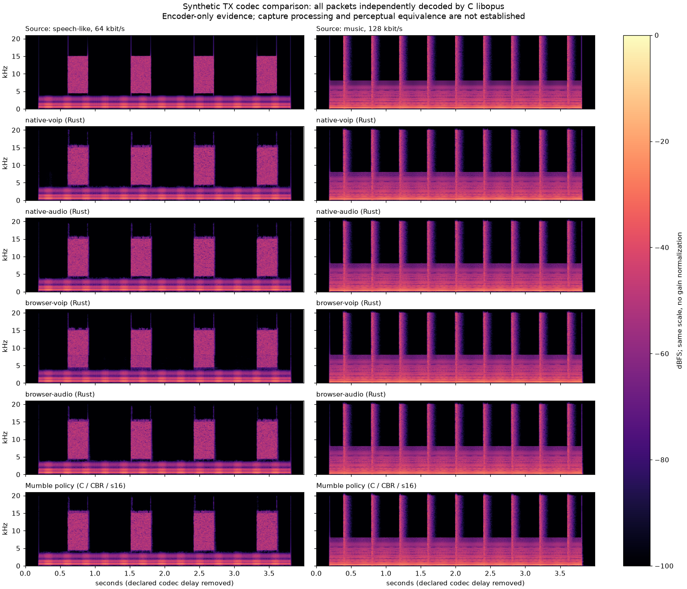

# Opus transmit quality audit

This is a transmit-side source audit, not a perceptual-equivalence result. The
user's reported quality difference needs measured encoding and capture evidence.
Receive/output measurements have a separate owner in `docs/output-quality.md`.
No host microphone, personal Mumble configuration or public server is sampled.

## Exact source identity

- Nuschl audited source: `caff0785`, with published `opus-pure` 0.2.3 plus the
  documented receive-only patches in `vendor/opus-pure/NUSCHL-PATCH.md`. The
  published archive SHA256 is
  `5afacd236411dddcc284983066ef66b27e306e53ce4de85cd745b3da9be8a0be`;
  retained upstream VCS revision is
  `3f6077b8bdc0f6c090c3b585de9294065a50e2a4`. Those receive patches do not alter
  the encoder.
- Pinned stock comparison: [Mumble v1.5.939 AudioInput.cpp](https://github.com/mumble-voip/mumble/blob/dfbac8d3d9c967003e74b4ffc5610f7d45e8f666/src/mumble/AudioInput.cpp),
  local tag `v1.5.939` = `dfbac8d3d9c967003e74b4ffc5610f7d45e8f666`.
  [Settings.h at the same revision](https://github.com/mumble-voip/mumble/blob/dfbac8d3d9c967003e74b4ffc5610f7d45e8f666/src/mumble/Settings.h)
  supplies defaults, not a claim about the user's saved settings.
- Current upstream is a distinct comparison:
  [master at 8c538851b25a8349e03807df33c159ad4fe1c63a](https://github.com/mumble-voip/mumble/blob/8c538851b25a8349e03807df33c159ad4fe1c63a/src/mumble/AudioInput.cpp),
  the remote HEAD observed on 2026-11-12. Do not label the local checkout
  `35dce9e4801fe52b2217f0d9f421d17b0aaf3bb0` as today's remote HEAD.
- Independent test-side codec is libopus 1.6.1. Its actual reported version,
  library hash and controls must accompany measurements. It is not claimed to
  be the exact dynamically linked codec of every Mumble distribution.

## Baseline encoder settings (`caff0785`, before the Audio change)

| Setting | Native live TX | Browser WASM TX | Mumble 1.5.939 |
|---|---|---|---|
| API sample rate/channels | 48,000 Hz / mono | 48,000 Hz / mono | 48,000 Hz / mono |
| Application | `Voip` | `Voip` | `RESTRICTED_LOWDELAY` if low-delay allowed and initial adjusted bitrate ≥64k; otherwise `AUDIO` at ≥32k; otherwise `VOIP` |
| Signal hint | automatic (`None`) | automatic (`None`) | automatic, no explicit `OPUS_SET_SIGNAL` |
| Bandwidth | automatic, max fullband | automatic, max fullband | automatic, no explicit bandwidth override |
| Complexity | 9, inherited crate default | explicitly 5 | inherited libopus default; 9 in test-side libopus 1.6.1 |
| Rate control | constrained VBR | constrained VBR | explicit CBR (`OPUS_SET_VBR(0)`) |
| DTX | off | off | codec default off; Mumble's external voice gate stops packets |
| In-band FEC/loss hint | enabled; 5% initially, configured loss clamped 1–30% | off / 0% | codec defaults off / 0%; no explicit setters in AudioInput |
| Packet duration | 20 ms, two 10 ms DSP frames | 20 ms, 960 capture samples | default 20 ms; adjusts packet count under tight server budgets |
| Requested bitrate | 128,000 bit/s | 128,000 bit/s | default 40,000 bit/s; user-configurable |
| Budget handling | current authenticated server budget wins | current authenticated server budget wins | adjusted codec bitrate + framing accounting; may enlarge frames |
| API PCM precision | float encode, default 24-bit analysis depth | float encode, default 24-bit analysis depth | signed 16-bit `opus_encode` |

Native controls are in `apps/media-worker/src/live.rs` (`run`, `Configure`,
`Transmit::encode`); WASM controls are in `crates/audio-wasm/src/lib.rs`
(`VoiceEncoder`). Both live paths cap each 20 ms encoded payload to
`bitrate_bps / 400` bytes, which is the target's 20 ms byte allowance. Browser
also imposes a 960-byte absolute ceiling. The native `--live` path must be
distinguished from the nonlive codec test IPC in `apps/media-worker/src/main.rs`,
which uses different FEC and output-buffer defaults.

The initial conservative server allowance is 72,000 bit/s. After reserving
24,000 bit/s for 50 packets/s of framing/transport, that gives a **48,000 bit/s
codec target**, not 128k. Reaching 128k requires sufficient advertised server
budget (at least 152k under this accounting). If fewer than 6k remain, TX is
disabled instead of exceeding the server budget. This audit does not change
bandwidth accounting, session authority or controls.

Mumble's application choice occurs when its encoder is constructed. Later
`setMaxBandwidth` updates bitrate/frame state without recreating that encoder;
do not infer an application switch from every live bitrate change. Its source
default is low-delay allowed, 40k and two 10 ms frames, so a fresh default encoder
uses `AUDIO`. At 128k with low-delay allowed a fresh Mumble encoder instead uses
`RESTRICTED_LOWDELAY`. Current upstream retains this application ladder and CBR
selection; its preprocessing implementation/version is separately identified.

## VoIP does not mean narrowband-only

The actual vendored TX encoder contains `CeltEncoder`, `SilkEncoder`, bitrate/
signal/complexity-driven mode selection, hybrid coding and fullband CELT. This is
verified from `vendor/opus-pure/src/encoder.rs`, not inferred from decoder support
or the `Application::Audio` name. `RestrictedLowDelay` forces CELT; `Voip` and
`Audio` select SILK/CELT from equivalent rate and voice/music analysis, then may
construct hybrid coding from the chosen bandwidth. A `Voip` encoder can emit
fullband CELT. Opus fullband audio reaches approximately 20 kHz; a 48 kHz PCM API
does not promise preservation through Nyquist.

The application remains a meaningful policy difference. Voice bias without a
classifier is 115 for VoIP versus 48 for Audio in this implementation. Tonality/
music/bandwidth analysis runs only at complexity ≥7: browser complexity 5 skips
it, while native default 9 includes it. Rate control and the loss/FEC estimate
also enter rate/mode decisions. Inspect actual packet TOC mode/bandwidth and
decoded spectra before assigning a reported sound difference to any one setting.
Switching only the enum is not a demonstrated quality fix.

## Capture defaults are another independent variable

Native capture follows the chosen device's rate/channel configuration, averages
its channels to mono and converts to 48 kHz. Non-48 kHz capture now uses the
scalar Rust Speex quality-3 filter, with exact-ratio clocks and capture-side
filter-delay compensation. At 48 kHz it preserves the input samples.

The default `AudioSettings` enable voice activity, sensitivity 0.5, noise
suppression, automatic gain and automatic echo handling. In the media worker:

1. Sonora's high-pass stage runs on 10 ms mono frames. Its AEC is enabled when
   the route needs Nuschl cancellation; recognized upstream AEC is reused instead.
2. A persistent Sonora/WebRTC RNN measures speech probability before local
   suppression and adaptive gain. Its model already ships with Sonora; this
   adds no model download. Its state survives gain/suppression setting changes.
   `nnnoiseless` RNNoise still supplies noise suppression: its processed PCM
   replaces capture when enabled, unless recognized upstream suppression already
   supplies it. RNNoise's probability is no longer the transmit decision.
3. Sonora AGC2 adaptive digital gain defaults on, with max gain 30 dB and limiter.
   Echo-dominant frames cannot raise gain beyond the remembered near-end ceiling.
   With AGC disabled, a soft limiter above 0.85 remains. The final native frame
   sanitizes nonfinite values and clamps to full scale.
4. The VAD gate combines the WebRTC speech probability with the unchanged
   processed-input floor (-60 dBFS) and 300 ms hangover. The shared
   `audio::gate_thresholds` opens at 0.9 / 0.4 / 0.1 for sensitivity 0% / 50% /
   100%, with two linear segments and a closing threshold half the opening
   threshold. **0% is stricter; 100% is more sensitive.** Calibration trades
   background rejection against quiet-speech onset; it is not a universal
   guarantee for every noise source. The current 80 ms processed-input prefix
   remains bounded and permission-scoped. PTT and continuous mode keep their
   explicit admission rules. Encoding and speech amplification are unchanged;
   no microphone is kept open while muted to warm up the detector.

Browser capture asks `getUserMedia` for mono/48k, echo cancellation, noise
suppression and automatic gain, then truthfully reports the browser's applied
settings. These requests are not equivalent to a specified RNNoise/AGC algorithm;
the browser/OS may choose or ignore processing. The AudioContext is explicitly
checked for 48 kHz, with a mono Worklet feeding 20 ms float PCM to isolated Rust
WASM. The browser has no separate native RNNoise/VAD processing in that encoder.
Permission and microphone activation remain explicit user actions.

Pinned Mumble defaults instead use Speex suppression at −30 dB, AGC and dereverb
through the Speex preprocessor, with AGC target 30000 in its 16-bit domain and
max gain derived from `iMinLoudness=1000`. Default echo option is Speex mixed;
actual backend/reference availability governs activation. ReNameNoise is a
separate selectable/build-dependent option in 1.5.939, not its default. Mumble
uses Speex resampling quality 3 for device conversion. Current upstream has moved
to a preprocessor wrapper and RNNoise 0.2, so its capture implementation must not
be substituted for the pinned 1.5.939 baseline.

## Measurement plan and open gates

The initial source audit `bb08f13f` changed no production setting. The later
Audio activation is described below; the historical matrix keeps its original
VoIP profiles and all failures.

- Compare identical, owned synthetic formant/fricative speech, harmonic and
  percussive music, impulses/transients, stepped high-frequency tones and
  multiband signals. Silence and 997 Hz alone cannot establish fidelity.
- Encode native/browser settings and Mumble's fresh-encoder application/CBR
  policy at 24/40/48/64/128k. Keep a separate matched Rust/C-settings comparison
  so application policy is not conflated with codec implementation error.
- Decode every transmitted packet with independent C libopus. Record actual
  TOC modes/bandwidths, payload-rate distribution, packet durations, lookahead,
  encode timing and all failures. Include reset and speech/music transitions.
- Use fixed gain and only declared/measured integer delay alignment. Report
  gain deviation separately; never fit it away. Spectrograms and band-envelope
  errors complement waveform residuals: a lossy codec may preserve spectral
  energy without waveform phase. Neither metric proves perceptual equivalence.
- Measure preprocessing separately from the encoder and then actual native
  private-device and browser synthetic-capture→TX→independent-decode paths. Keep
  native-vs-browser differences explicit. No host device or personal profile.
- Preserve failed baselines before proposing a bounded settings correction.
  Capture SRC, stereo/music presets, browser preprocessing controls and broad
  codec defects need separate allocation/approval; receive parity is separate.

Existing `tests/opus_eval.py` is insufficient as the final TX gate: it exercises
the nonlive IPC and a C VoIP comparator, has an outdated 64k assumption, and its
quality score fits a least-squares gain after delay search. Keep that historical
evidence but do not present it as current live Mumble-policy or fixed-gain parity.

## Audio activation and measured limits

The user approved Audio as the fidelity choice, with RestrictedLowDelay only if
quality equivalence is demonstrated. Production checkpoint `a235fe87` (integrated
as `95a1a27f`) now selects **`Application::Audio` for every production TX
constructor**: native live capture, native codec IPC and browser `VoiceEncoder`.
A small shared native factory prevents those two native paths drifting. A search
of `apps`/`crates` finds remaining VoIP constructors only inside deliberate test
fixtures. Bitrate changes, including server-forced 32/48k, never switch back to
VoIP. The requested 128k, server reserve/limits, mono 20 ms framing, complexity,
CVBR, live FEC/loss hints, microphone consent and epochs are unchanged. Live
capture/startup and receive conversion were not redesigned here.

The native factory test encodes/validates/decodes real multitone packets across
128→32→48→64→128k and resets, verifying the actual Audio application and original
controls. Native tests pass **71/71 with five pre-existing ignored diagnostics**;
audio-WASM native tests pass 8/8. The actual wasm-bindgen artifact exposes a numeric
`lookahead_samples()` query; it reports 312 samples, matching independent C
`OPUS_GET_LOOKAHEAD` for Audio. RestrictedLowDelay reports120 on both Rust and C:
192samples / **4ms** less algorithmic codec delay. This is not measured
microphone-to-speaker or end-to-end call latency.

The standalone matrix contains **1,008 rows**: four deterministic signal types,
24/32/40/48/64/128k, seven policy profiles, Rust/C encoding and no loss / fixed
isolated loss / fixed two-packet bursts. It records requested controls separately
from actual TOC modes/bandwidth, size/rate, lookahead and encode time. Every packet
is decoded by independent C libopus 1.6.1. Synthetic speech-like formants/fricatives
are not a human speech corpus. Common-scale spectrograms and IEEE-float WAVs keep
original gain/headroom; no fitted gain, lag or per-file normalization is applied.
The delay is the queried codec lookahead, not an optimization of the score.

The following no-loss reconstruction scores are **fixed-gain waveform SNR in dB**,
not perceptual scores or universal quality guarantees. Mumble here means its
pinned fresh-encoder policy running in test-side C libopus, with s16 input, CBR,
complexity9 and no requested FEC; it does not include Mumble capture processing.

| Target / synthetic input | Native baseline VoIP | Native Audio | Browser baseline VoIP | Browser Audio | Mumble policy / C |
|---|---:|---:|---:|---:|---:|
|64k speech-like|13.55|16.62|7.95|16.88|16.83|
|64k music|12.30|13.93|6.66|14.12|13.80|
|64k transients|9.38|13.54|4.77|13.77|14.07|
|64k stepped highband|15.56|23.31|8.64|24.42|23.54|
|128k speech-like|25.56|25.56|25.81|25.81|25.97|
|128k music|19.27|19.27|19.30|19.30|19.31|
|128k transients|16.91|16.91|16.95|16.95|16.93|
|128k stepped highband|23.67|23.67|24.88|24.88|23.54|

At 128k these VoIP/Audio profiles already selected CELT and produce identical
outputs in the tested cases. At 64k the old browser VoIP profile stays hybrid,
while Audio selects CELT; native VoIP has mixed hybrid/CELT. These observations
explain a plausible mode-dependent difference at lower effective budgets, but do
not establish what the user's particular microphone/room/server actually did.
A128k request must not be mistaken for128k effective codec rate on a 72k server.

The plot compares64k speech-like input and128k music with the same−100…0dBFS
scale. Before/after Rust profiles and the actual C Mumble-policy encoder are
explicitly labeled. It is encoder-only evidence. The full eight high-resolution
plots, loss cases, raw packet streams and float WAVs remain in the source-bound
handoff. The committed [scoped report](reviews/2026-11-12-opus-tx/report.json)
contains controls, source/actual-path scores and open findings.

### Why RestrictedLowDelay is still open

The4ms delay reduction alone does not meet the user's equivalence condition.
With Rust 64k transient input, Audio→RLD falls13.54→10.01dB (native controls) and
13.77→10.01dB (browser controls). The matched C browser controls instead give
13.78→14.05dB. At 128k browser speech-like input Rust drops25.81→23.75dB, while
matched C gives25.79→25.73dB. Fixed burst loss retains the64k transient difference
(native−4.10dB, browser−4.27dB relative to Audio). Preserve those failures rather
than changing gain or declaring identical quality from the CELT TOC alone.
Sparse-transient rate allocation also differs from matched C; variable rate on
silence by itself is not proof of a defect. Diagnose timing/window/analysis and
bit-allocation behavior before an RLD at 64k+ policy is activated.

Requested FEC is not proof that redundant audio was coded. With native FEC5%
controls, C Audio chooses hybrid for some packets at 64/128k in these fixtures;
Rust Audio remains CELT. RLD cannot supply SILK/hybrid FEC. This difference needs
an explicit codec/policy review, including actual loss recovery, before broad
resilience or equivalence claims. Browser complexity5 versus native9 remains
unchanged and queued. No vendor or entropy/mode-selection code was patched here.

### Actual production constructors and retained portability diagnostic

`tests/opus_tx_actual.py` validates 20 actual paths: the native codec IPC at 128k,
and the shipped wasm-bindgen `VoiceEncoder` at 32/48/64/128k, for each of the four
signals. It checks valid finite independent-C decoded output, 200×20 ms packets,
WASM budget caps and the actual 312 sample delay query. Example actual WASM scores
versus matched C controls: 32k speech9.336/9.503dB; 128k speech25.836/25.786dB;
128k transients16.958/16.936dB. This is separate from a full browser microphone/
preprocessing/transport test. The native live factory's budget/reset behavior is
unit-tested; native IPC is not substituted for proof of the live DSP pipeline.

A deliberately stricter new native/WASM encoded-output equality diagnostic failed
and is retained: the first 32k speech-like case gives39.77dB between the decoded
outputs instead of 60 dB. Across all sixteen WASM cases that diagnostic spans
29.53–47.42dB. Valid Audio selection and close independent source metrics do not
make those encodes bit-identical. The script reports equality separately; an
explicit `--require-control-snr-db 60` reproduces that optional failing gate.
No existing quality assertion was relaxed. This is a separate portability/
floating-encoder investigation, not a demonstrated corruption or a closed gate.

The exact Audio worker also passes the full existing privatePulse DSP suite:
jitter, upstream AEC routing/overrides, echo 42 dB removal/0%sent, double talk 1.2 dB/
100% gate, clipping detection and sound isolation / 6 dB volume. The fixture explicitly
forces the private Pulse backend and synthetic null sinks, with no host capture.
These regressions do not close physical-device capture quality, the linear
CaptureConverter, browser processing differences or broad perceptual parity.

Artifacts and commands: `~/.cache/nuschl-opus-tx-quality/handoff.json`.
The original 672-row baseline, additional 336 server-forced 32/40k rows, failing
cross-target equality case and all fixed-loss/RLD failures are preserved. Source
is frozen; filtered receive/SRC/reference work has a separate owner.
