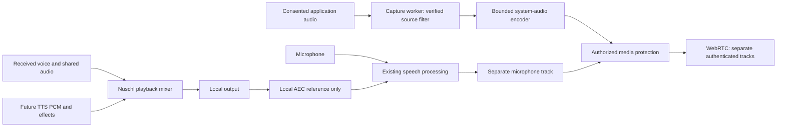

# Optional audio with screen sharing

Design requested 2026-11-11; platform documentation checked that day. This is
future work, not an implemented capture feature or a claim of tested platform
support. Enable sharing audio only when the selected backend can exclude every
Nuschl playback source covered by the session. Otherwise offer a narrower,
verified application source or video without audio.

## Current implementation and prerequisites

The native driver has one media worker per application, shared across its server
connections: [the supervisor](../crates/client/src/native/media.rs) routes
microphone packets and playback with connection generations and mute revisions.
[Live media](../apps/media-worker/src/live.rs) mixes received voice, sound effects
and local test playback into its output. Its `record_output()` deliberately
records the output device's complete mix as an **AEC reference**. It is not a
screen-share capture source. Using that reference as outgoing audio would
recapture the call. Keep it local, including its existing all-output coverage.

[TTS and captions](speech.md) are planned. TTS is required to return PCM to the
owned playback mixer; inference has no audio-device handles. The current
[WebRTC transport trial](../crates/rtc/src/lib.rs) transports encoded packets,
with one audio track, optional video, a two-media-section SDP bound and one
initial offer/answer. It does not integrate screen capture, a second audio
track, production calling/SFU routing or SFrame. The [sandbox policy](../SECURITY.md)
and [media launchers](../crates/ipc/src/host.rs) already separate device/codec
processing from session credentials. None of those boundaries should be weakened
for this feature.

First extend authenticated media negotiation to distinguish microphone audio,
screen-share audio and video, and test the new bounded track model. Increasing
the SDP limit alone is insufficient: track lookup currently selects by audio or
video kind. A screen share with microphone audio needs at least three distinct
media roles; camera plus screen needs another video role. Preserve bounded
negotiation and scheduling, and define restart/renegotiation behavior before
opening capture devices.

## Exclusion contract and routing

The guarantee concerns direct digital recapture of Nuschl's playback, including
all listened-to servers, received screen-share audio, preview/test tones,
notifications and future TTS. It must cover playback workers and chime processes,
not merely the desktop UI PID. It cannot remove audio another application has
independently recorded and replayed, or prevent acoustic pickup by a microphone.
Those are different paths; microphone AEC remains useful but is not a security
boundary.

Maintain a supervisor-owned set of playback owners: process handles and start
identity, backend object identities and generation, and application instance.
Include all cooperating local Nuschl instances before claiming desktop-wide
exclusion. Descriptive names, executable basenames, process roles and caller-set
properties alone are not ownership evidence. A newly started playback worker
must register its output objects and complete an exclusion barrier **before it
plays**. Worker restarts, process/object ID reuse and audio-server reconnects
invalidate that evidence. Unknown ownership closes the outgoing audio gate.
This registration/barrier is proposed work; current CPAL labels do not supply it.

Use a separate capture worker for OS capture APIs and their FFI, without
microphone access, network access, TLS/MLS keys, chat history or general home
access. A Rust wrapper does not make an underlying OS/native implementation
memory-safe. Prefer memory-safe processing; retain narrowly reviewed platform
exceptions inside restricted workers. The existing media sandbox is a reference,
not proof that a screen-capture worker has the necessary permissions.

Do not subtract Nuschl PCM from a full desktop recording or use AEC, RNNoise,
voice detection, ducking or a residual-echo detector as the exclusion mechanism.
Their errors and timing differences can leak call content. A correlation alarm
may stop a share as an additional safeguard; passing it does not prove exclusion.
Never monitor the outgoing shared-audio track locally, and never feed it into
microphone/caption capture automatically.

## Linux: observe individual streams, preserve existing routes

Prefer an allowlist of selected playback streams tapped before the device mix.
For a later desktop-wide mode, sum eligible non-Nuschl playback streams, admitting
new streams only after ownership classification. Do not capture a whole sink and
hope to filter its mixture afterward. Do not move unrelated applications to a
virtual sink, change defaults, alter their volume/mute state, remove their links,
or rewrite WirePlumber/PulseAudio configuration.

For native PipeWire, prototype Nuschl-owned capture/mixer nodes and additional
links from permitted application output ports, leaving existing playback links
intact. Check graph access, port formats and whether a particular source allows
an additional link; this is a proposed adapter, not a promise that every backend
exposes suitable ports. Denied or exclusive sources remain unsupported. PipeWire
models nodes/ports/links explicitly and provides object serials and passive-link
properties. Use server/object generation plus serial identity, not a recycled
numeric node ID. [PipeWire overview](https://docs.pipewire.org/page_overview.html),
[object and link keys](https://docs.pipewire.org/group__pw__keys.html).

Do not trust `application.name` or `application.process.id` as an authentication
boundary. PipeWire documents that clients can modify non-`pipewire.*` properties;
`pipewire.sec.pid` is protocol supplied, but represents `pipewire-pulse` for
PulseAudio clients. For those streams, correlate the exact objects registered by
Nuschl's own playback connections; the proxy PID cannot distinguish applications.
[PipeWire property security notes](https://docs.pipewire.org/page_man_pipewire-props_7.html).

PulseAudio has a useful concrete primitive: a recording stream connected to a
sink's monitor can select **one sink input** with
`pa_stream_set_monitor_stream()`, called before `pa_stream_connect_record()`.
Create independent recording streams for eligible inputs, combine their PCM in
Nuschl, and follow changes through introspection/subscription. Never treat the
sink monitor alone as filtered output. Revalidate source identity after moves,
removal and reconnect; keep transmission closed until binding/removal semantics
are verified against real PulseAudio and PipeWire's PulseAudio implementation.
[PulseAudio stream API](https://freedesktop.org/software/pulseaudio/doxygen/stream_8h.html),
[server introspection](https://freedesktop.org/software/pulseaudio/doxygen/introspect.html).

The generic ScreenCast portal documentation currently describes monitor/window/
virtual-display sources and a restricted PipeWire remote, without specifying an
audio-selection/exclusion contract. Do not infer system-audio authorization from
a successful video chooser. Broker portal requests in the trusted application;
grant a worker only the resulting descriptors/objects it needs. Native audio
socket access is broader than a video portal grant and needs its own permission
and sandbox review. ALSA-only capture, opaque mixed sources or denied stream
access fall back to audio off, without taking over hardware or rerouting other
applications. [ScreenCast portal API](https://flatpak.github.io/xdg-desktop-portal/docs/doc-org.freedesktop.portal.ScreenCast.html).

## Windows: process-loopback filtering, not ordinary endpoint loopback

Use `ActivateAudioInterfaceAsync` with `AUDIOCLIENT_ACTIVATION_PARAMS` and
`AUDIOCLIENT_PROCESS_LOOPBACK_PARAMS`. For selected applications, use
`PROCESS_LOOPBACK_MODE_INCLUDE_TARGET_PROCESS_TREE`; for all other applications,
use `PROCESS_LOOPBACK_MODE_EXCLUDE_TARGET_PROCESS_TREE` only when its target tree
covers the complete Nuschl playback-owner set. Microsoft specifies a minimum of
Windows build **20348**, and the capture is not tied to one physical endpoint.
Probe support at runtime; a generic Windows 10 label is insufficient.
[Process parameters](https://learn.microsoft.com/en-us/windows/win32/api/audioclientactivationparams/ns-audioclientactivationparams-audioclient_process_loopback_params),
[include/exclude modes](https://learn.microsoft.com/en-us/windows/win32/api/audioclientactivationparams/ne-audioclientactivationparams-process_loopback_mode),
[Microsoft sample explanation](https://learn.microsoft.com/en-us/samples/microsoft/windows-classic-samples/applicationloopbackaudio-sample/).

Excluding the capture worker excludes the wrong tree: voice playback belongs to
another worker. Use the stable application ancestor and prove every playback
helper is its descendant. The API accepts one target PID, not an arbitrary set of
sibling application instances. Do not exclude the shell or a shared OS service
to manufacture a common ancestor. If ownership spans several independent trees,
restrict capture to verified selected application trees or disable system audio.
A future shared playback broker could make exclusion tractable, but requires a
separate design and is not implemented or required by this document.

Keep process handles/lifetime evidence through capture, invalidate on target
exit and recreate the filter before resuming. Prove API activation works within
the intended Windows sandbox; the current microphone-capable media AppContainer
does not establish process-loopback support for a new worker. If confinement or
process filtering fails, report unavailable rather than silently falling back
to endpoint loopback or launching an unrestricted helper. Protected/exclusive or
otherwise unavailable application audio may produce silence; do not bypass OS
restrictions or advertise capture success solely because activation succeeded.

## macOS: explicit application filters must cover helpers

ScreenCaptureKit's `capturesAudio` is opt-in; its audio capture/current-process
exclusion properties are available from macOS **13**. Set
`excludesCurrentProcessAudio = true`, but do not treat that switch as a documented
exclusion of every separate Nuschl helper/process tree. In a capture worker,
"current process" is not the voice playback worker. Explicitly exclude the
`SCRunningApplication` entries corresponding to all playback owners, and validate
how signed bundled helpers/background processes are represented. If any owner
cannot be represented or excluded, desktop-wide audio is unavailable.
[Audio configuration](https://developer.apple.com/documentation/screencapturekit/scstreamconfiguration/capturesaudio),
[current-process exclusion and availability](https://developer.apple.com/documentation/screencapturekit/scstreamconfiguration/excludescurrentprocessaudio.md),
[application exclusion filter](https://developer.apple.com/documentation/screencapturekit/sccontentfilter/init(display:excludingapplications:exceptingwindows:)).

Apple documents audio filtering at the **application** level, even when the video
filter selects one window. Sharing a browser window can therefore include sound
from other windows/tabs in that application. Explain that scope explicitly;
never label it window-only audio. Keep the user's video selection independent
of the audio filter: where necessary, use a video-only stream and a separate
explicitly filtered audio stream. Re-including a Nuschl window as a video filter
exception must not accidentally re-include its sound. Application-only audio is
a fallback only when that application's sound is itself sufficiently scoped;
otherwise share video without audio. [Apple's ScreenCaptureKit filtering discussion](https://developer.apple.com/videos/play/wwdc2022/10155/).

Use the system chooser/permission flow and handle revocation as a stop, including
for the signed worker arrangement; do not assume the existing Core Audio sandbox
covers ScreenCaptureKit or broaden it wholesale. Disable ScreenCaptureKit's
microphone capture: the existing independently controlled microphone remains its
own source. Request no unrelated accessibility permission or virtual audio
driver. [Apple ScreenCaptureKit guidance](https://developer.apple.com/documentation/screencapturekit),
[screen/system-audio permission controls](https://support.apple.com/guide/mac-help/control-access-screen-system-audio-recording-mchld6aa7d23/mac).

## TTS, application instances and externally rendered sounds

All future Kokoro output must follow [the speech design](speech.md): inference
returns bounded PCM, and Nuschl's owned mixer renders it. The same rule covers
notifications, previews and any future platform TTS backend. Synthesizing into
buffers/streams is an available API pattern on
[Windows](https://learn.microsoft.com/en-us/uwp/api/windows.media.speechsynthesis.speechsynthesizer.synthesizetexttostreamasync)
and [Apple platforms](https://developer.apple.com/documentation/avfaudio/avspeechsynthesizer/write(_:tobuffercallback:)).
Do not ask an external speech service to play directly and assume a Nuschl PID
filter will remove it. Use application-controlled notification sounds instead of
unattributable OS-broker playback when sharing audio.

If TTS or any Nuschl playback escapes the registered owner set, close shared
audio before that playback starts. Allow local playback to continue while the
share is silent and explain the unsupported combination. Other application
instances must cooperate with this exclusion barrier; a separate old build or
browser-hosted call cannot be assumed covered by a native process-tree filter.
Future web/mobile screen sharing needs its own exclusion and consent design.

## Media policy, controls and failure behavior

- Give system audio its own authenticated track purpose, share ID, owner,
  conversation, recipients and generation. Never inject it into the microphone
  encoder or silently translate it into ordinary legacy Mumble voice. Legacy
  peers can keep using supported voice/text; unsupported screen media stays off.
- Keep mic mute/PTT, camera, screen video and shared audio independently visible
  and controlled. Mic mute need not stop an explicitly active desktop-audio
  track; the UI must continue showing that audio is being shared. An explicit
  **mute all outgoing audio** action stops microphone, shared audio and transmitted
  TTS without changing the camera. **Stop sharing** stops the selected share's
  video/audio, not an unrelated microphone conversation. Deafen stops all
  outgoing audio for that destination. Moderator mute, authorization
  loss and channel changes must not be bypassed through the share track.
- Require a fresh local choice before capture/transmit; an OS permission alone
  does not authorize a server or remote participant to start it. Show source,
  application-wide audio scope, destination, active audio state and immediate
  stop control. Default audio sharing off; reconnect must not silently broaden
  the source or restore a stopped share. No default recordings or caption/TTS
  ingestion of system audio.
- Keep callbacks nonblocking. Propose stereo 48 kHz content audio with bounded
  timestamped PCM queues and separate Opus encoding. Do not apply speech AGC,
  RNNoise or voice-activity gates to music. Resample clocks explicitly, bound
  drift/queues and drop stale frames with a visible gap instead of accumulating
  latency. Adapt bitrate to leave microphone audio responsive before video;
  the trial's single-audio bandwidth reservation needs revision for two tracks.
- Honor relay-only privacy in the network owner: no direct candidates, peer
  address advertisement or discovery/STUN probes when forbidden. Capture workers
  receive no sockets. Existing file-transfer relay support is not an implemented
  screen-sharing SFU or TURN policy. Authenticate media signaling and recipients
  before transmitting; no plaintext/legacy fallback on MLS-required servers.
- DTLS-SRTP to an SFU is transport encryption, not group E2EE. Future screen video
  and both audio tracks need SFrame with authorized MLS-exported keys, independent
  sender/track counter/key domains and replay protection. Keep keys outside
  capture/codec workers. Reject stale membership/track epochs before sending;
  MLS availability alone cannot turn the media indicator green. Until this is
  implemented and verified, preserve the current encrypted-server media block.
  See [the media architecture](architecture.md) and [SFrame design](e2ee.md).
- Ownership/filter changes close the transmit gate, discard buffered PCM/encoded
  frames and restart with fresh capture/route generations. Permission denial,
  sound-server restart, device move, worker crash or uncertain filtering never
  switches to an unfiltered monitor. Update only Nuschl's own capture objects;
  independent microphone/camera operation must remain responsive.

## Delivery stages and private verification

1. Specify authenticated track roles, permissions, bounded negotiation/queues,
   route generations and stop semantics. Test with encoded synthetic frames,
   without device capture. Add the playback-owner registration barrier and
   metadata needed to prove exclusions; keep global mixed capture disabled.
2. Prototype application-only native adapters in isolated workers using Rust
   platform bindings. Validate source scope, process identity and actual sandbox
   permissions separately on each OS. Add the optional UI only for proved modes.
3. Add all-other-application capture only where the full owner set is excluded,
   including worker replacement and cooperating instances. Failure retains
   app-only selection or audio off. Do not add a broker, global virtual sink or
   broad sandbox exception merely to make a prototype appear cross-platform.
4. Integrate authenticated signaling, relay enforcement, authorization and the
   separate SFrame/MLS work; validate end-to-end failure handling before claiming
   production screen-sharing audio.

Use distinctive synthetic PCM fixtures: external app A, second external app B,
Nuschl remote voice, received screen audio, local TTS and UI/test sounds. Assert
that allowed sources arrive and excluded sources do not, before encoding and
again after a private loopback receive/decode. Check sample provenance/correlation
against exact fixtures rather than merely listening for a quieter echo. These are
release tests to implement, not tests performed for this document:

- Linux NixOS VMs: private PipeWire and PulseAudio instances with null/software
  sinks, no host runtime sockets or `/dev/snd`. Exercise native and PulseAudio
  compatibility clients, selected/all-app scopes, new streams, index/serial
  reuse, output moves, existing echo-cancellation graphs and repeated daemon
  restarts. Compare unrelated graph links/defaults/volumes before and after.
- Disposable Windows guest: synthetic audio only, registered helper/child and
  sibling-instance playback, process exit/reuse, several endpoints, activation
  failure, older unsupported OS versions and actual sandbox denials. Exercise
  all mute/deafen/permission transitions without host loopback capture.
- Disposable macOS guest or dedicated test machine: signed fixture app/helpers,
  synthetic playback, app/window selection differences, helper enumeration,
  current-process flag versus explicit app filters, multiple instances and TCC
  denial/revocation. No personal desktop, real calls or accessibility audio.
- Cross-platform unit/private-call tests: denied track negotiation, stale
  capture/recipient epochs, new-member/key changes, relay-only packet/address
  checks, crash/backpressure recovery, source/filter update barriers, simultaneous
  mic mute with explicit shared audio, global audio mute and stop-all-sharing.

A supported platform/mode must demonstrate the exclusion at every lifecycle
transition before the UI claims call audio is excluded. An unproven combination
remains unavailable rather than falling back to audible-content suppression.
